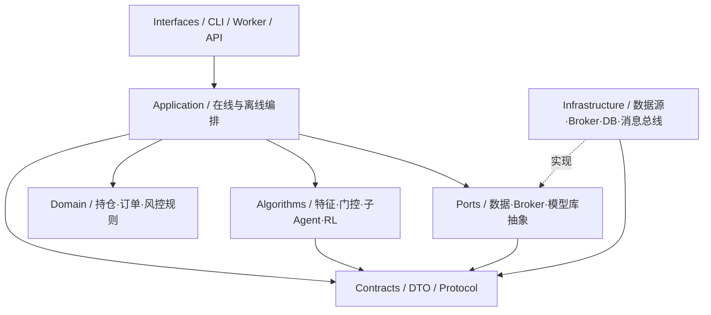
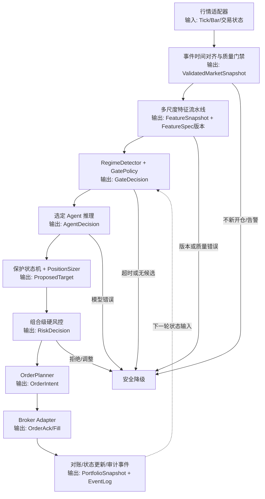
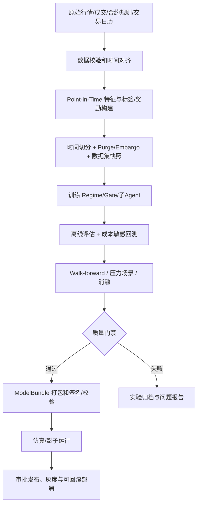

# Python 商品期货多 Agent 强化学习系统：编码与架构规范

> **目标**：让系统在策略快速迭代的同时，保持交易逻辑可解释、风险边界不可绕过、在线离线语义一致、实验可复现、生产故障可审计。  
> **架构基线**：**模块化单体 + 轻量 DDD + 六边形架构 + 函数式核心/命令式外壳 + Protocol 优先**。  
> **适用范围**：行情与特征、市场状态识别、上层门控、趋势/均值回归/防御子 Agent、仓位与风控、执行、训练、回测、模型发布、可观测性。

## 0. 文档约定与适用边界

### 0.1 规范等级

| 等级 | 含义 | 验收方式 |
|---|---|---|
| **MUST（必须）** | 不满足不得合入核心分支或进入实盘 | 静态检查、自动测试、发布门禁、代码评审 |
| **SHOULD（应该）** | 默认执行；偏离需要说明理由 | PR 说明或 ADR |
| **MAY（可以）** | 团队按性能和复杂度选择 | 不设强制门禁 |

本规范是**工程基线**，不是交易策略收益保证，也不替代合规、交易所和经纪商的具体约束。数值阈值（如最大杠杆、决策延迟、单品种限额）由版本化配置和风控审批确定，不在规范中随意设定。

### 0.2 非目标

- 不要求所有算法对象使用 DDD Entity/Aggregate/Repository 模式。
- 不要求上线初期拆分为微服务。
- 不强制某种 RL 算法（PPO、SAC 等）或模型框架。
- 不允许将研究环境的便利性直接当作实盘可靠性。

### 0.3 架构总原则

1. **策略只提出建议，不直接下单。**
2. **风控在任何策略、门控和模型之上**；安全约束在在线/回测都生效。
3. **同一决策时刻只能使用当时可用的信息**；特征及标记必须有可用时间。
4. **研究/回测/实盘共享契约和业务核心**，差异放在适配器、时钟、执行与数据源。
5. **模型与特征、动作空间、风控配置、数据和代码版本一起发布**。
6. **任何一个交易意图都能关联回原始行情、特征快照、门控选择、Agent 版本和风控结论**。
7. **所有可能导致真实订单的失败场景，都有显式降级或阻断行为**。

---

## 1. 架构与依赖规则

### 1.1 逻辑组件图



> `Domain` 保持独立：**禁止 Domain 依赖 Algorithms**；`Algorithms` 也不应绕过 Application 直接接触业务状态或订单执行。实际导入方向必须遵守下表。

### 1.2 模块依赖白名单

| 来源模块 | 允许依赖 | 禁止依赖 |
|---|---|---|
| `contracts/` | Python 标准库、少量明确批准的基础类型库 | `domain/`、`algorithms/`、`application/`、`infrastructure/` |
| `domain/` | 标准库及经批准的纯领域辅助库 | PyTorch、Broker SDK、DB、`application/`、`infrastructure/` |
| `algorithms/` | `contracts/`、数值/ML 库 | `infrastructure/`、Broker SDK、订单发送实现 |
| `ports/` | `contracts/` 和稳定领域接口类型 | 具体数据库、行情平台、Broker SDK |
| `application/` | `contracts/`、`domain/`、`algorithms/` 接口、`ports/` | 具体基础设施实现（由启动装配层注入） |
| `infrastructure/` | `contracts/`、`ports/`、必要的领域对象 | 反向调用应用层内部编排 |
| `interfaces/`、`bootstrap/` | `application/`、适配器、配置 | 将业务决策逻辑写在入口 |

**MUST**：使用导入边界检查（例如 `import-linter` 或等价脚本）阻止非法依赖。  
**SHOULD**：一个业务能力跨越三个以上模块时记录 ADR（架构决策记录）。

### 1.3 推荐仓库目录

```text
trading-system/
├── pyproject.toml
├── uv.lock
├── README.md
├── docs/
│   ├── architecture/
│   ├── adr/
│   ├── contracts/
│   └── runbooks/
├── configs/
│   ├── base/
│   ├── markets/
│   ├── agents/
│   ├── risk/
│   └── experiments/
├── src/trading/
│   ├── contracts/
│   │   ├── market.py
│   │   ├── features.py
│   │   ├── decisions.py
│   │   ├── events.py
│   │   └── versions.py
│   ├── domain/
│   │   ├── market/
│   │   ├── portfolio/
│   │   ├── execution/
│   │   └── risk/
│   ├── algorithms/
│   │   ├── features/
│   │   ├── regime/
│   │   ├── gating/
│   │   ├── agents/
│   │   │   ├── trend/
│   │   │   ├── mean_reversion/
│   │   │   └── defensive/
│   │   ├── rl/
│   │   └── rewards/
│   ├── ports/
│   │   ├── market_data.py
│   │   ├── broker.py
│   │   ├── model_registry.py
│   │   └── event_store.py
│   ├── application/
│   │   ├── online/
│   │   ├── offline/
│   │   ├── backtest/
│   │   └── model_release/
│   ├── infrastructure/
│   │   ├── market_data/
│   │   ├── brokers/
│   │   ├── storage/
│   │   └── telemetry/
│   ├── bootstrap/
│   └── interfaces/
│       ├── cli/
│       ├── api/
│       └── workers/
├── tests/
│   ├── unit/
│   ├── contract/
│   ├── integration/
│   ├── replay/
│   ├── backtest/
│   └── e2e/
└── scripts/
```

**MUST**：禁止出现通用的 `utils.py`/`helpers.py` 大杂烩。跨模块复用代码必须有清晰所有者和语义。  
**MUST**：不得由 `algorithms/agents/*` 导入任何 Broker 实现。

---

## 2. Python 编码约定

### 2.1 Python 与风格

- **MUST**：项目固定受支持 Python 版本范围；建议从 Python **3.12** 起，升级需先通过兼容性测试。
- **MUST**：`src/` layout、包内绝对导入、公开函数类型注解；禁止 `from x import *`。
- **MUST**：使用 `ruff format` + `ruff check`，统一行宽 **100**。
- **MUST**：禁止在核心交易路径使用无约束 `Any`，例外须标注原因和边界转换。
- **MUST**：禁止可变默认参数；所有可选值显式用 `T | None`。
- **SHOULD**：函数专注单一职责；超过约 50 行的业务函数进行结构审查，而不是机械拆分。
- **SHOULD**：数值/特征模块优先使用纯函数，避免修改输入数组。
- **SHOULD**：公开 API 包含说明其输入语义、时间条件、异常或返回约束的 docstring。

命名约定：

| 类型 | 规范 | 示例 |
|---|---|---|
| 模块/函数/变量 | `snake_case` | `build_feature_snapshot` |
| 类/协议 | `PascalCase` | `TradingAgent` |
| 常量 | `UPPER_SNAKE_CASE` | `MAX_SIGNAL_AGE` |
| 私有实现 | `_leading_underscore` | `_normalize_action` |
| 单位 | 单位进入字段名 | `latency_ms`, `price_ticks`, `quantity_lots` |
| 时间 | 时间语义进入字段名 | `event_time`, `available_at`, `decision_at` |
| 版本 | 用专门字段 | `feature_spec_version`, `model_version` |

### 2.2 数据对象、校验、精度

- **MUST**：内部小型值对象优先 `@dataclass(frozen=True, slots=True)`；外部 JSON/配置边界可用 Pydantic 做校验。
- **MUST**：`frozen=True` 不意味着其中的 NumPy 数组不可变。共享数组必须复制、设为只读，或显式声明所有权。
- **MUST**：订单数量使用**整数手数**，价格遵循最小变动价位；资金/手续费等需要精确计量处优先整数最小货币单位或 `Decimal`，不得直接用未经规则处理的浮点比较确定是否允许下单。
- **MUST**：带单位的值不混用；百分比、基点、实际价格变化、收益率分别标注。
- **MUST**：对 `NaN`、`Inf`、缺失、越界值定义统一策略；不能将其默默转换成正常决策。
- **MUST**：协议和持久化数据类型带 `schema_version`，重大不兼容修改升级主版本。

### 2.3 Protocol 优先，慎用继承

**MUST**：Agent、Gate、MarketData、Broker、ModelRegistry 等可替换组件通过 `Protocol` 或小型接口抽象交互。  
**SHOULD**：组合优于深层继承；不为每个简单函数强制创建 `Service/Factory/Repository` 类。

示意（专注类型契约，省略了配置/初始化）：

```python
from dataclasses import dataclass
from datetime import datetime
from enum import Enum
from typing import Protocol


class ActionKind(str, Enum):
    HOLD = "hold"
    TARGET_EXPOSURE = "target_exposure"


@dataclass(frozen=True, slots=True)
class AgentObservation:
    decision_id: str
    symbol: str
    decision_at: datetime
    feature_spec_version: str
    values: tuple[float, ...]  # 小示例；高维数据可使用只读张量/数组
    current_position_lots: int


@dataclass(frozen=True, slots=True)
class AgentDecision:
    decision_id: str
    agent_id: str
    model_version: str
    action: ActionKind
    target_exposure: float | None  # [-1, 1]；HOLD 时必须为 None
    confidence: float


@dataclass(frozen=True, slots=True)
class GateDecision:
    decision_id: str
    selected_agent_id: str
    gate_version: str
    switch_reason: str
    regime: str


class TradingAgent(Protocol):
    def predict(
        self,
        observation: AgentObservation,
        *,
        deterministic: bool = True,
    ) -> AgentDecision: ...


class Gate(Protocol):
    def select(self, observation: AgentObservation) -> GateDecision: ...
```

**契约附加约束（MUST）**：

1. `target_exposure` 是**归一化目标风险暴露**，不是下单手数；从暴露到手数由独立的 `PositionSizer` + 风控完成。
2. `HOLD`（不主动改变目标）**不等于** `TARGET_EXPOSURE=0`（主动清仓目标）；实际订单由应用层结合当前仓位及安全规则计算。
3. `confidence` 必须在 `[0, 1]`，且不能仅凭它绕过风控或当作已校准的概率。
4. Agent 不得读实时账户、修改全局仓位或直接发送订单。
5. 上例是简化接口；生产实现必须验证时区感知时间、动作合法性、`decision_id` 一致性、数值有限性及兼容版本。

---

## 3. 领域模型与交易语义

### 3.1 核心实体和职责

| 模型 | 核心职责 | 不应承担 |
|---|---|---|
| `InstrumentSpec` | 交易所、合约乘数、tick、手数及涨跌停/交易约束 | 预测收益 |
| `MarketBar` | OHLCV、合约、区间和可用时间 | 自动判断可交易 |
| `TradingSession` | 交易日历、夜盘、休市及特殊时段 | 依赖本机日期猜交易日 |
| `PortfolioSnapshot` | 账户/资金/敞口/持仓快照 | 调用模型 |
| `OrderIntent` | 经过审批的拟执行目标或委托要求 | 实际下单 |
| `Order` / `Fill` | 订单状态、成交和费用 | 假设必然成交 |
| `RiskPolicy` | 绝对限制、预交易检查与停机规则 | 用 Agent 置信度取代限制 |
| `StrategyRuntimeState` | 门控记忆、持仓锁定、止损状态、冷却期 | 隐式放入模型权重 |

### 3.2 交易状态机

**MUST**：订单状态至少覆盖 `CREATED → SUBMITTED → ACKNOWLEDGED → PARTIALLY_FILLED / FILLED / CANCELED / REJECTED`，并处理乱序/重复回报。  
**MUST**：`OrderIntent`、`Order`、`Fill`、`Position` 四种概念分离，不得以“下单成功”推断“成交成功”。  
**MUST**：持仓来源以经纪商/交易所回报和对账后的状态为准，禁止仅依据 Agent 输出更新真实持仓。  
**MUST**：建立决策、订单和成交关联 ID，支持重复消息幂等处理。

### 3.3 量化期货特别规则

- **MUST**：区分品种、具体交易合约、连续合约；连续合约价格不能直接当成真实委托价格。
- **MUST**：显式管理换月映射、移仓成本和数据复权方式；不能将复权价格直接作为成交价。
- **MUST**：风险与回测考虑合约乘数、tick、保证金、手续费、交易所限制、滑点、涨跌停/停盘、交易时段和品种流动性。
- **MUST**：收盘/跨节/夜盘的逻辑依据**交易所交易日**而非自然日。
- **MUST**：是否允许同日平仓、平今/平昨、最小下单手数等以所交易市场与经纪商规则为准。
- **SHOULD**：在组合层管理跨品种相关风险、保证金占用和集中度，不局限于单策略的局部风控。

---

## 4. 时间、数据与特征契约

### 4.1 强制时间字段

| 字段 | 含义 | 要求 |
|---|---|---|
| `event_time` | 事件市场时间 | 时区明确、可追溯 |
| `bar_start`/`bar_end` | K 线区间 `[start, end)` | 不混用开闭区间 |
| `available_at` | 数据在本系统**最早可用**的时间 | 不得晚于使用该数据的决策时刻 |
| `ingested_at` | 本系统实际收到该数据的时间 | 用于延迟审计 |
| `decision_at` | 决策固定的逻辑时刻 | 同一重放输入产生一致决定 |
| `trading_day` | 交易所定义的交易日 | 与自然日区分 |

**MUST**：持久化时间戳统一为 UTC 且带时区；交易时段由交易所时区（例如中国市场的 `Asia/Shanghai`）日历解释。  
**MUST**：对 10 分钟 K 线，明确闭合判断、迟到数据窗口、行情水位线和重放修正策略。  
**MUST**：多尺度输入（如 10m/30m/1h/日级）按 `available_at <= decision_at` 做 point-in-time join，不能把尚未收完的高周期 Bar 当成已闭合 Bar 使用。  
**MUST**：禁止 `shift(-1)` 等未来信息流入训练观察或实盘特征；未来收益只能出现在监督标签/奖励构造中，并遵循严格索引约束。

### 4.2 FeatureSpec 是版本化契约

每个特征至少记录：

```yaml
name: atr_14_10m
dtype: float32
unit: price
bar_interval: 10m
window: 14
min_history: 15
source_fields: [high, low, close]
availability_rule: closed_bars_only
missing_policy: reject_decision
normalization: train_fitted_v1
feature_spec_version: "2.1.0"
```

- **MUST**：在线、离线及回测**复用同一特征定义**；批处理和流式实现若不同，必须通过黄金样本一致性测试。
- **MUST**：训练时拟合的 scaler/encoder 参数作为模型包的一部分冻结；禁止以全量未来数据拟合归一化参数。
- **MUST**：特征按名称、顺序、dtype、单位、时间窗及版本校验，不能只按张量形状接受输入。
- **MUST**：数据修订、停牌、缺口、异常值的处理需显式记录。
- **SHOULD**：建立数据集版本或哈希、特征快照哈希和统计漂移监控。

---

## 5. 多尺度门控与子 Agent 契约

### 5.1 模式与职责

推荐将 **RegimeDetector（状态识别）**、**GatePolicy（策略路由）** 与 **TradingAgent（动作生成）** 分开：

| 组件 | 输入 | 输出 | 禁止行为 |
|---|---|---|---|
| `RegimeDetector` | 多尺度市场特征、交易时段和质量标记 | Regime 类型、分数、置信度/质量 | 下单 |
| `GatePolicy` | Regime、门控历史、候选 Agent 可用性、持仓状态 | Agent 选择、切换理由、有效期 | 直接改账户持仓 |
| `TrendAgent` | 自己版本化的 Observation、必要的策略状态 | 目标暴露/HOLD、诊断信息 | 修改止损边界 |
| `MeanReversionAgent` | 同上 | 同上 | 修改仓位硬限额 |
| `DefensivePolicy` | 门控/模型/数据故障和账户状态 | HOLD、限制新开仓或风险批准的降险请求 | 在账户未知时盲目平仓 |

**MUST**：门控输出含 `selected_agent_id`、`gate_version`、`switch_reason`、`regime`、`decision_id`。  
**MUST**：上层门控与子 Agent **分别版本化和独立评估**；兼容矩阵由模型发布流程校验。  
**MUST**：动态切换存在**切换滞回/冷却/最短持续期**或经过论证的等价机制，避免在阈值附近振荡。  
**MUST**：策略切换时定义持仓交接规则；新 Agent **不得假设仓位为零**。  
**SHOULD**：趋势锁定（trend lock）、追踪止损（trailing stop）作为可审计的独立策略状态/保护规则，而不是隐式散落在 Agent 模型内部。

### 5.2 决策优先级（安全优先）

建议的运行时决策顺序：

1. **全局停机开关/强制安全控制**：阻止增加风险；任何主动降险动作仍必须经过订单与账户校验。
2. **账户、交易所和硬风控约束**：保证金、净/总敞口、可用资金、交易权限、合约有效性。
3. **已生效的保护规则**：追踪止损、最大亏损/回撤控制、退出条件。
4. **门控与策略切换规则**：滞回、冷却、趋势锁定、交接。
5. **子 Agent 建议**：仅在前述规则允许时被转成目标持仓。
6. **执行可行性检查**：价格/数量合法性、限价区间、报单幂等、流动性、连接状态。

**MUST**：上述优先级由单一 `DecisionPolicy`/`RiskPolicy` 入口表达并测试。  
**MUST**：门控不可以覆盖已经触发的硬风控或有效保护性止损。  
**MUST**：任何“保护性平仓”同样需要状态准确、交易通道可用和经纪商约束校验；不能因为名义上降低风险就绕过执行校验。

### 5.3 Agent 生命周期

**MUST**：定义 `load → warm_up → ready → predict → shutdown` 生命周期，明确模型失败、超时与恢复行为。  
**MUST**：在线推理使用固定推理模式；如采用随机采样策略，必须有显式授权、固定版本与随机性审计。  
**MUST**：状态型 Agent（RNN、Transformer 缓存、锁定状态）需声明作用域（账户/品种/合约/Agent 实例），并支持重启恢复或安全重建。  
**MUST**：模型推理错误不能穿透到 Broker API；由应用层处理并记录降级原因。

---

## 6. 在线决策：组件、输入输出与失败策略

### 6.1 组件流程



### 6.2 阶段契约（最小集合）

| 阶段 | 输入物 | 输出物 | 强制校验 |
|---|---|---|---|
| 行情接入 | Tick、交易状态、合约元数据 | `ValidatedMarketSnapshot` | 来源、时间、重复/迟到、交易时段 |
| 特征计算 | 多尺度已可用行情、FeatureSpec | `FeatureSnapshot` | 顺序、窗口、可用时间、NaN、版本 |
| 门控 | 特征、Regime、持仓及切换记忆 | `GateDecision` | Agent 可用性、切换状态、理由 |
| Agent | 版本化 Observation、模型包 | `AgentDecision` | 输入输出维度、动作范围、超时 |
| 仓位规划 | 建议暴露、账户/合约、保护规则 | `ProposedTarget` | 整数手数、tick、敞口语义 |
| 风控 | 拟议目标、组合快照、限制 | `RiskDecision` | 限额、保证金、杠杆、日内阈值 |
| 订单规划 | 审批后的目标、未完成订单 | `OrderIntent` | 幂等键、净委托、交易所约束 |
| 执行与回报 | 意图、Broker 回报 | `OrderAck/Fill/OrderState` | 超时、重试、重复回报、状态迁移 |
| 对账与审计 | 经纪商状态、订单事件 | 新 `PortfolioSnapshot`、事件流 | 状态一致性、审计链路 |

### 6.3 在线故障处理矩阵

| 故障 | 默认行为 | 不允许 |
|---|---|---|
| 市场数据过期/缺失 | 阻断新增风险、报警、保留安全监控 | 使用“最后价格”默默继续开仓 |
| 模型文件/FeatureSpec 不兼容 | 禁止该模型进入 ready | 强行 reshape 输入或忽略版本 |
| Gate 或 Agent 超时 | 进入配置化安全策略并记录事件 | 假装 Agent 返回了 HOLD |
| 风控服务不可用 | **默认禁止增加风险**；降险动作走受控恢复流程 | 绕过风控发订单 |
| Broker 网络中断 | 冻结新意图，查询未决委托后恢复 | 不知道委托状态就重试同一单 |
| 本地/经纪商持仓不一致 | 冻结风险增加并人工/自动对账 | 仅凭内存持仓继续执行 |
| 交易限制/市场关闭 | 拒绝不合法订单，延后到可执行窗口需重新审批 | 盲目缓存并在下一交易日原样发送 |

**MUST**：定义决策超时预算、数据新鲜度阈值、订单超时与对账超时；数值来自环境/市场配置。  
**MUST**：重试使用稳定的**幂等键**并先查明订单状态，避免重复下单。  
**MUST**：线上每一步生成带同一 `decision_id` 的结构化事件。

---

## 7. 离线训练、验证与模型发布

### 7.1 离线流程



### 7.2 阶段输入输出物

| 阶段 | 输入物 | 输出物（应保存） |
|---|---|---|
| 数据构建 | 原始市场数据、合约配置、交易日历 | `dataset_manifest.json`、时间切分、校验报告 |
| 特征生成 | Dataset、FeatureSpec、拟合窗口 | 特征快照、编码器/归一化参数、泄漏检测报告 |
| Agent/Gate 训练 | 训练集、种子、代码/环境、奖励/动作定义 | checkpoint、训练日志、超参数、metrics |
| 策略评估 | 验证/测试集、成交与费用模型、硬风控 | 回测交易逐笔、净值、风险/换手/容量报告 |
| 稳健性验证 | 跨品种/跨阶段/换月/极端场景 | Walk-forward 结果、消融、压力测试结论 |
| 打包 | 候选模型、FeatureSpec、动作空间、风控契约 | `model_bundle/`、manifest、哈希、兼容声明 |
| 发布 | 经批准模型包、影子实盘结果 | 发布记录、批准人、版本、回滚指针 |

### 7.3 数据泄漏与回测真实性

- **MUST**：时间序列采用按时间切分，不以普通随机划分代替时序验证。
- **MUST**：标签或持仓结果跨越边界时实施 purge/embargo 或经过论证的等价防泄漏方法。
- **MUST**：训练拟合数据（scaler、状态识别、阈值、选品规则）不能包含未来验证/测试窗口。
- **MUST**：门控、子 Agent、策略切换与组合风控在回测中按线上同顺序执行。
- **MUST**：回测计入手续费、滑点/冲击、换月、成交延迟、拒单、可成交量及保证金影响；无法可靠估计的部分必须说明。
- **MUST**：模型评估使用未用于选模型的时间段/品种（或严格嵌套的选模流程），防止反复试参污染最终测试。
- **SHOULD**：进行跨市场阶段、品种和制度变化的稳健性分析，不用单一 Sharpe 判断可发布。

### 7.4 ModelBundle 最小清单

```text
model_bundle/
├── manifest.json
├── gate_model.bin
├── agents/
│   ├── trend.bin
│   └── mean_reversion.bin
├── feature_spec.json
├── normalization.bin
├── action_spec.json
├── runtime_compatibility.json
├── risk_contract.json
└── checksums.sha256
```

`manifest.json` **MUST** 包含：

`bundle_id`、`model_version`、`gate_version`、`agent_versions`、`feature_spec_version`、`action_spec_version`、`training_dataset_id`、`git_commit`、`config_hash`、`created_at`、`supported_instruments`、`runtime_python`、关键库兼容范围及文件校验和。

**MUST**：模型包不可原地修改；发布采用不可变版本 ID，切换/回滚具备原子性。  
**MUST**：研究产物不得被生产路径直接加载，必须通过模型仓库和发布门禁。

---

## 8. 配置、依赖与环境

### 8.1 配置治理

- **MUST**：业务参数、交易时段、合约规格、风险阈值、Agent 启停、模型版本通过配置注入；禁止写死在交易函数里。
- **MUST**：环境变量只用作配置输入或密钥引用；绝不将凭据写入代码、模型包或日志。
- **MUST**：配置有 schema 校验、默认值边界与版本；启动时生成 `effective_config` 的**脱敏快照及哈希**。
- **MUST**：实盘配置与研究配置显式区分；生产环境不能意外启用训练时探索/模拟执行。
- **SHOULD**：Hydra 等实验配置工具只用于需要的实验复杂度，生产启动配置尽量清晰可审计。

### 8.2 依赖锁定

**MUST**：采用单一依赖管理工作流（建议 `uv`），提交锁文件，训练与生产运行环境可还原。  
**MUST**：第三方库升级经过单元、契约、回放、性能和模型兼容性验证。  
**SHOULD**：核心交易进程依赖保持精简，避免无关重型训练库强制安装在生产容器。

### 8.3 `pyproject.toml` 规范片段

> 以下为**示例片段**；包元数据、具体依赖与工具版本应由仓库实际环境补齐。

```toml
[project]
name = "commodity-rl-trading"
version = "0.1.0"
requires-python = ">=3.12,<3.14"

[tool.ruff]
line-length = 100
target-version = "py312"

[tool.ruff.lint]
select = ["E", "F", "I", "B", "UP", "SIM"]

[tool.pyright]
include = ["src"]
typeCheckingMode = "standard"
reportMissingTypeStubs = "warning"

[tool.pytest.ini_options]
testpaths = ["tests"]
addopts = "-ra --strict-markers"
```

**MUST**：`contracts/`、`domain/`、`application/online/`、`domain/risk/` 在 CI 中达到更严格的类型检查；算法框架动态类型可用受限边界适配层隔离，并在 PR 说明豁免。

---

## 9. 错误处理、日志与可观测性

### 9.1 错误边界

- **MUST**：区分 `DataQualityError`、`ContractMismatchError`、`ModelUnavailableError`、`RiskRejected`、`BrokerTransientError`、`BrokerPermanentError`、`ReconciliationError`。
- **MUST**：在应用层边界将异常映射到明确的业务结果，不能在最外层 `except Exception: pass`。
- **MUST**：可重试错误与不可重试错误分离；重试具有限次、退避、幂等性和熔断条件。
- **MUST**：交易路径不得静默吞掉订单、持仓或风控异常。
- **SHOULD**：预期业务拒绝使用明确返回值（如 `RiskDecision.REJECTED`），异常用于系统或不变量故障。

### 9.2 审计事件

每个在线决策至少记录：

```json
{
  "event_type": "decision_completed",
  "schema_version": "1.0",
  "decision_id": "example-uuid",
  "event_time": "2026-10-11T10:00:00Z",
  "instrument": "EXAMPLE.CONTRACT",
  "feature_spec_version": "2.1.0",
  "feature_snapshot_hash": "sha256:...",
  "gate_version": "g4",
  "selected_agent_id": "trend",
  "agent_model_version": "a7",
  "action": "target_exposure",
  "risk_outcome": "approved",
  "order_intent_id": "example-order-intent-id",
  "reason_codes": ["REGIME_TREND", "RISK_OK"]
}
```

**MUST**：真实生产日志中避免泄露凭据、账户标识和敏感个人数据；必要的内部标识采用脱敏和访问控制。  
**MUST**：审计事件 append-only 或具备不可篡改审计机制；保留周期按公司与监管要求配置。

### 9.3 指标与报警

至少监控：行情新鲜度、Bar 迟到率、特征缺失率、在线/离线特征偏差、门控切换率、Agent 推理延迟 P50/P95/P99、决策失败率、风控拒绝率、订单拒绝/撤单率、未决委托数、持仓对账偏差、模型版本分布、实际交易成本偏差。

**MUST**：报警有责任人、分级、抑制与故障操作手册（runbook）。  
**MUST**：策略收益指标和系统健康指标分开报警；策略亏损不能仅由系统异常告警代替。

---

## 10. 测试策略与质量门禁

### 10.1 测试分层

| 层级 | 重点 | 必须覆盖的代表场景 |
|---|---|---|
| Unit | 纯规则与数值函数 | 止损优先级、取整/tick、NaN、时段边界 |
| Contract | DTO/Protocol、版本兼容 | 缺字段、非法动作、错误版本、时间无时区 |
| Integration | 适配器和编排 | Broker 回报乱序、幂等、断线恢复、模型仓库加载 |
| Replay | 离线事件重放与线上一致性 | 相同市场/状态快照得到一致决策 |
| Backtest | PnL 与交易细节 | 换月、手续费、滑点、部分成交、涨跌停 |
| E2E / Simulation | 端到端生命周期 | 数据进入到风控、模拟委托、成交、对账 |
| Failure / Chaos | 故障降级 | 模型超时、缺失 Bar、风控宕机、Broker 断连 |

### 10.2 强制不变量（MUST）

1. Agent 无法直接访问 Broker 端口。
2. 风控拒绝时不能生成可发送的增加风险订单。
3. 相同 `decision_id`/幂等键不能产生重复真实订单。
4. `feature.available_at > decision_at` 时决策必须拒绝该特征。
5. 特征、Agent、Gate、动作定义版本不兼容时禁止模型就绪。
6. 重放中的同一输入、配置、模型和初始状态，确定性策略返回同一决策结果。
7. 订单未成交不能直接增加已成交持仓。
8. 保护止损/硬风控生效时门控切换不能覆盖它。
9. 合约无效、交易所休市或经纪商账户未知时不能违规开仓。
10. 不允许 `NaN/Inf` 跨过下单参数验证边界。

### 10.3 覆盖率与性能

- **MUST**：上述不变量各有可自动运行的测试。
- **MUST**：影响交易安全的 `domain/risk`、执行状态机和订单规划组件纳入关键路径覆盖率门禁；建议行覆盖率基线 **≥ 90%**，同时要求分支及边界场景审查（覆盖率并不证明正确）。
- **SHOULD**：普通核心模块先以 **≥ 85%** 行覆盖率为参考，不以堆测试追求全局数字。
- **MUST**：发布前对真实预期吞吐/负载执行在线决策延迟测试；阈值由系统 SLO 定义，不在这里拍脑袋指定。
- **SHOULD**：采用性质测试和黄金样本测试，尤其针对时序边界、风险上限和计算精度。

---

## 11. CI、代码评审与发布流程

### 11.1 PR 最小门禁

```text
提交/PR
  ├─ 格式检查：ruff format --check
  ├─ 静态检查：ruff check
  ├─ 类型检查：pyright
  ├─ 导入层级检查：import boundary
  ├─ 单元与契约测试：pytest tests/unit tests/contract
  ├─ 密钥扫描和依赖安全检查
  └─ 评审通过
       └─ 合并到主分支
```

建议命令（按实际安装环境执行）：

```bash
uv sync --locked
uv run ruff format --check .
uv run ruff check .
uv run pyright
uv run pytest tests/unit tests/contract -q
```

`uv run` 所调用工具应作为开发依赖安装并锁定版本；不要假设所有 CI runner 都预装这些工具。

### 11.2 变更分类

| 变更类型 | 审查要求 |
|---|---|
| 命名、格式、注释 | 常规 PR |
| 特征定义、Observation、动作空间 | 升级版本 + 黄金样本/契约测试 |
| Agent 或 Gate 参数/结构 | 离线评估 + 模型兼容验证 |
| 订单、持仓或风控规则 | 双人评审 + 风险边界测试 + 回放 |
| 行情可用时间、Bar 聚合、交易日历 | 时序一致性测试 + 历史重放 |
| 生产模型发布 | 评估报告 + 审批 + 影子/灰度 + 回滚预案 |

### 11.3 发布门禁与回滚

**MUST**：生产发布前至少证明：模型包完整、特征契约匹配、离线评估已批准、仿真/影子验证通过、风险阈值审查通过、告警生效、回滚可执行。  
**MUST**：策略灰度、模型回滚、紧急停机有明确操作步骤；控制面不能依赖故障中的 Agent 才能停机。  
**MUST**：回滚同时检查模型、FeatureSpec、动作解释和状态格式兼容；不能只回滚权重文件。  
**SHOULD**：将新模型运行的交易与旧模型影子决策并行记录，量化决策差异和成本偏差。

---

## 12. 安全、权限与环境隔离

- **MUST**：`research`、`backtest`、`paper`、`production` 环境用不同凭据、账户/权限和明确的运行模式隔离。
- **MUST**：研究/测试环境默认**不可访问真实 Broker 报单凭据**。
- **MUST**：生产订单权限最小化、凭据定期轮换、秘密集中管理。
- **MUST**：实盘启动需要环境、账户、品种白名单与交易模式三重校验。
- **MUST**：模型和日志不可执行任意外部脚本；反序列化外部工件必须采用可信来源及安全加载策略。
- **MUST**：代码、模型产物和依赖供应链进行基本完整性校验。
- **SHOULD**：从策略训练到生产审批采取职责分离。

---

## 13. 性能优化的边界

性能优化不得破坏可追溯性与正确性。

**MUST**：
- 先做端到端性能剖析，再考虑 Cython、Numba、批量推理或异步化。
- 在线 `predict()` 不执行模型训练、远程依赖安装或不可控耗时的数据下载。
- CPU/GPU 模型推理、线程池和数据缓冲区有明确的资源上限与超时。
- 共享模型对象和缓存遵守线程/进程安全边界。
- 异步消息处理不改变同一订单/账户需要保证的事件顺序；并行计算和串行提交清晰分开。

**SHOULD**：以 10 分钟决策窗口为业务周期，但不要将 10 分钟误认为允许交易执行无限阻塞；实际 SLO 仍需由执行市场和故障要求决定。

---

## 14. 团队协作与文档制度

### 14.1 每个业务模块至少包含

- `README.md`：用途、输入输出、公开接口、依赖与负责人。
- 契约定义：DTO、schema version、错误语义和单位。
- 测试：正常、边界、失败。
- 运行配置：默认参数、风险限制来源和环境差异。
- 必要时提供 ADR：为何选择算法/状态管理/处理顺序。

### 14.2 PR 模板

```markdown
## 变更说明
- 目标：
- 影响模块：
- 是否影响生产决策/订单/风控：是 / 否

## 契约与版本
- FeatureSpec 是否变化：
- ActionSpec 是否变化：
- Gate/Agent/模型包兼容性：
- 配置变更和迁移方式：

## 验证
- 静态与类型检查：
- 单元/契约/回放测试：
- 回测或仿真评估：
- 失败场景：
- 性能影响：

## 发布与回滚
- 发布步骤：
- 回滚策略：
- 审计/告警变更：
- 评审人：
```

### 14.3 ADR 模板

```markdown
# ADR-XXXX：<决策标题>
- 状态：提出 / 接受 / 废弃
- 日期：
- 背景与约束：
- 方案与选择理由：
- 被否决的替代方案：
- 风险与权衡：
- 对在线/离线一致性的影响：
- 迁移、验证和回滚方式：
```

---

## 15. 关键验收清单（可直接用于工程评审）

### 架构

- [ ] 算法、领域、应用、接口、基础设施依赖方向正确。
- [ ] Agent、Gate、Broker、市场数据均通过可替换契约连接。
- [ ] 实盘 Broker API 没有被 Agent/特征代码直接调用。
- [ ] 在线与离线共享交易规则、特征定义和风控核心。

### 时间和数据

- [ ] 所有数据具有明确的交易时间与可用时间。
- [ ] 高周期特征按 point-in-time 语义加入 10 分钟决策。
- [ ] 已实现夜盘、节假日、换月与合约规则处理。
- [ ] 特征缺失、迟到、异常和漂移有明确处理。
- [ ] 防止训练和回测中的未来信息泄漏。

### 模型与决策

- [ ] 门控切换有滞回、冷却或等价机制。
- [ ] 趋势锁定/追踪止损与 Agent 切换优先级明确。
- [ ] HOLD 与清仓目标语义不同。
- [ ] 模型包绑定特征、动作、版本和训练数据。
- [ ] Agent 不可绕过组合风控或发送订单。
- [ ] 超时、不兼容和失败进入安全降级模式。

### 订单和风控

- [ ] 委托意图、订单、成交、持仓状态清晰分离。
- [ ] 订单重试具备幂等控制，对账后恢复。
- [ ] 未知持仓或风控不可用时不增加风险。
- [ ] 下单数量、价格、保证金、时段和合约检查完整。
- [ ] 有人工可操作的停机与回滚预案。

### 工程质量与发布

- [ ] Ruff、Pyright、pytest 和模块依赖检查进入 CI。
- [ ] 关键交易不变量有自动化测试。
- [ ] 能重放每个 `decision_id` 的数据和模型版本。
- [ ] 实验具有数据/代码/配置/随机种子追溯能力。
- [ ] 模型生产发布经过仿真、审批、审计和回滚检查。

---

## 16. 分阶段落地建议

| 阶段 | 目标 | 主要交付物 | 验收标准 |
|---|---|---|---|
| **P0：基础治理** | 包结构、类型、自动化检查 | `pyproject.toml`、边界约束、CI、核心 DTO | PR 无法绕过基础门禁 |
| **P1：在线安全闭环** | 单品种从决策到模拟订单 | 状态机、风控、幂等、审计、故障矩阵 | 可安全重放/对账，故障不误下单 |
| **P2：多 Agent 门控** | 趋势/均值回归/防御完整切换 | Gate、Agent 接口、保护规则、切换测试 | 切换与止损优先级可验证 |
| **P3：离线研究闭环** | 特征、训练、回测、发布一致 | Dataset/ModelBundle、Walk-forward、评估报告 | 无已知未来函数，回测可复现 |
| **P4：仿真与受控发布** | 生产候选治理 | 影子交易、告警、灰度、回滚、runbook | 通过发布门禁与演练 |

> **最终准则**：宁可少一个抽象层，也不能少一个时间语义、风控边界、幂等约束或审计事件。对于商品期货 RL 系统，这些是架构规范真正的价值所在。

---

## 附录 A：MUST 规则的自动化映射

| 规则 | 推荐自动检查 | 人工/集成验证 |
|---|---|---|
| 风格、导入、类型 | Ruff、Pyright | PR 评审 |
| 模块依赖单向性 | import-linter/架构测试 | ADR 审核 |
| 数据契约/动作范围 | Pydantic/dataclass 校验、pytest | 兼容性评审 |
| Point-in-time 特征 | 黄金样本、性质测试、回放 | 数据血缘检查 |
| 风控不可绕过 | 契约测试 + E2E 故障注入 | 风控审批 |
| 订单幂等与对账 | 集成测试、模拟 Broker | 事故演练 |
| 模型包完整性 | manifest 校验、checksums、CI | 发布审批 |
| 线上故障降级 | chaos/replay 测试 | runbook 演练 |
| 训练与回测复现性 | 数据/环境/配置 manifest、固定随机性 | 研究复核 |
| 模型发布与回滚 | pipeline gate、影子对比、回滚演练 | 生产发布批准 |

## 附录 B：建议的工程决策优先级

当**代码简洁性、模型灵活性、性能、交易安全**出现冲突时：

1. **交易安全、交易所和账户约束**
2. **时间语义、数据正确性和状态一致性**
3. **可审计、可复现、可回滚**
4. **可维护、可测试**
5. **研究迭代速度**
6. **局部性能优化与设计形式上的纯粹性**

这不是限制算法创新，而是明确：**可获利的策略必须能够被可靠、可控地执行**。
