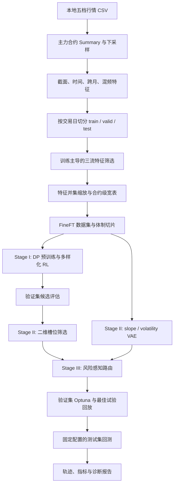
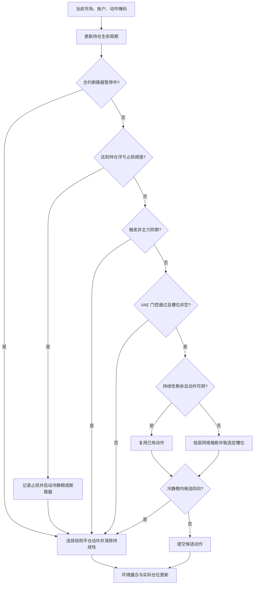

# FineFT / DiHFT 项目架构文档

> v2.0 · 当前实现快照 · 2026-10-11
>
> 源码基线：`f5a04610f878c0ac87eb6531843ac71d5829e426`。本次研究开始时 Git 工作区无未提交改动。本文以该工作区源码为首要依据，以 `fu / 10min` 九步流水线为具体配置样本，覆盖数据、训练、选优、路由、仿真、诊断与运行管理。
>
> 本文重新组织并校正 [v1 文档](2026-10-11-trading-strategy-architecture.zh_cn.md)，保留旧文件。这里的“最新”表示当前仓库实现，不表示已重新训练的最佳模型、交易所最新规则或经实盘验证的生产系统。

## 1. 阅读范围与证据规则

### 1.1 这是什么系统

FineFT 是一个以历史行情驱动的数据处理、强化学习训练和回测研究工程。当前商品期货主线使用三流特征、低层 Q 网络集成、双轴 VAE 体制评分和规则化高层路由，最终输出逐合约回测轨迹、模型选择记录与诊断报告。入口由 Bash 编排，计算主要由 Python 模块完成，阶段间主要通过 Feather、NumPy、JSON、PyTorch checkpoint 和 CSV 交换数据。[S01][S02][S03]

本文描述的九步主线没有把真实券商订单发送、订单回报、成交对账、实时行情服务或跨合约共享资金账户作为执行环节。因此，本文中的“执行”指历史行情仿真环境内的仓位调整；“风险控制”指该仿真循环内的规则，不代表实盘成交保证。[S01][S17][S25]

### 1.2 如何理解文中的数值

| 口径 | 含义 | 示例 |
| --- | --- | --- |
| 实现契约 | 由类、函数和文件格式决定 | Qnet 接收五路输入；路由槽位数由 Selection Manifest 决定 |
| Python 默认值 | 不传参数时入口或构造器使用的值 | 特征筛选 `DEFAULT_RL_PROFILE` |
| 脚本配置 | 当前 `fu_10` 脚本显式传入或环境变量默认值 | 训练 `action_persistence=6` |
| 本地数据快照 | 本次只读检查实际文件得到的结果 | 当前 RL 特征列表长度为 148 |
| 设计意图 | ADR 或领域文档中的目标、动机 | 降低无效换手、隔离三流统计目标 |
| 未验证结论 | 本次没有运行对应实验的效果判断 | 收益提升、吞吐倍数、实盘有效性 |

源码、脚本与 ADR 不一致时，本文明确标注差异，不自动把 ADR 视为已实现事实，也不修改原 ADR。每节引用的一手来源位于文末；源码符号比行号更适合作为长期定位依据。

### 1.3 阅读导航

- 理解整体：第 2–3 节。
- 数据和训练维护：第 4–8 节。
- 路由、执行和资金口径：第 9–11 节。
- 运行复现：第 12–14 节。
- 旧文修正、已知差异和后续工作：第 15–16 节。

## 2. 系统边界与总体架构

### 2.1 六个职责层

| 层 | 输入 | 职责 | 输出及消费者 |
| --- | --- | --- | --- |
| 行情与特征层 | 本地商品期货五档 CSV | 合约集合、交易日处理、下采样、截面/时间/跨月/混频特征 | 合约级特征表，供切分与筛选 |
| 数据治理层 | 特征表、主力合约 Summary | 时间切分、三流筛选、缩放、体制切片、清单记录 | RL 数据集、VAE 数据集、特征列表和 manifests |
| 低层策略层 | RL 状态、环境账户信息、DP 教师 | 预训练、多样化探索、选择性更新、候选评估 | 多 epoch、多子网络候选 |
| 模型筛选与表征层 | 验证切片、候选模型、VAE 训练数据 | 选择体制槽位模型；训练双轴 VAE | 组装模型、Selection Manifest、VAE 与参考分数 |
| 路由与仿真层 | 上述模型、当前历史行情 | 风险判断、槽位选择、动作持续性、撮合和账户推进 | 逐合约资产、奖励、动作及原因轨迹 |
| 研究分析层 | 轨迹、模型与数据清单 | 参数选优、指标汇总、OOD 与摩擦诊断 | CSV、JSON、Markdown、图表 |

这些层是仓库中的模块职责边界，不是独立部署的微服务。[S01][S02][S13][S18][S25]

### 2.2 端到端依赖图



Stage II 同时包含低层候选筛选和 VAE 边界识别；不能把整个项目缩减成“训练一个低层网络，再训练一个高层网络”。当前主线路由器是启发式规则与已训练网络的组合，不是九步入口中再训练的高层 RL 策略。[S01][S02][S18][S25]

### 2.3 训练信息与决策信息的边界

DP 教师、分段趋势标签和前向收益标签是离线训练/研究信息。回测决策使用当前状态、账户信息和 VAE 分数，不能把未来分段标签或 DP 最优动作当作当时可观测的输入。训练集的 `regime_grid_id` 用于经验分层和奖励塑形，属于离线训练条件。[S09][S10][S16][S17]

## 3. 仓库地图与入口

| 目录或文件 | 主线职责 |
| --- | --- |
| `run_fu_10min_pipeline.sh`、`run_fu_5min_pipeline.sh` | 顶层九步编排、步骤选择、dry-run、日志定位 |
| `data_preprocess/operator_futures/commodity/` | 商品定义、五档行情处理、主力合约、交易时钟、跨月和混频特征 |
| `data_preprocess/operator_futures/feature_selection/muti_contract/` | 多合约特征筛选、统计审计、三流分发 |
| `data_preprocess/operator_futures/scale_describe_save/` | 缩放、执行列保留、NaN 校验、缩放清单 |
| `FineFT/datahandler/` | 合约数据集、训练块、共享体制阈值、切片、VAE 数据物化 |
| `FineFT/model/` | 低层 Qnet/ensemble_Qnet，以及其他高层模型定义 |
| `FineFT/RL/DiHFT/low_level/` | DP 预训练、多样化训练、共享模型/数据、持久 worker、异步评估 |
| `FineFT/RL/DiHFT/VAE/` | 双轴 VAE 训练、分数分析与汇总 |
| `FineFT/RL/DiHFT/high_level/` | 门控、路由、分位数预计算、Optuna、最终回测 |
| `FineFT/RL/util/` | 回放池、体制分层经验与其他 RL 工具 |
| `FineFT/env/` | 环境构造、动作约束、账户推进、撮合、DP 奖励计算 |
| `FineFT/analysis/` | 候选筛选、交易诊断、特征/策略 OOD 分析和绘图 |
| `FineFT/common/` | 文件名、动作原因枚举、指标与路由参数列名 |
| `FineFT/script/` | 数据、训练、测试和分析阶段的具体实验配置 |
| `FineFT/tests/`、`data_preprocess/tests/`、`tests/` | 不同层级的行为测试 |
| `CONTEXT.md`、`docs/adr/`、`docs/specs/` | 领域词汇、决策背景和设计规范 |

仓库还保留 `RL/base/`、`RL/EarnHFT/`、`RL/SL/` 和 `RL/DiHFT/ablation/`，用于基线、监督学习或消融研究；它们不自动属于 `fu_10` 九步主线。旧 README 中的 BNBUSDT、25 档盘口和单份 `vae_state_features.npy` 不能直接当作当前商品期货配置。[S01][S02][S03]

## 4. 行情、特征与时间语义

### 4.1 原始行情契约

商品期货使用本地 CSV，典型根路径为 `data/原始下载/{品种中文名}/{YYYY}`。品种配置包含 `symbol`、五档深度、交易 Session、买卖费率、Contract Unit 和保证金参数。当前配置表列有 `fu` 与 `al`；这些是仓库研究参数，不等于最新交易所费率表。[S04]

- **TradingDay** 决定文件和日级统计归属；**事件时间戳**依据 `ActionDay + UpdateTime` 表示实际事件时间。
- 下采样采用右闭右标窗口 `(t-Δt, t]`，须保留 Session 边界语义。
- 商品期货仅使用真实 1–5 档，不补出不存在的 6–25 档。历史目录名 `ORDERBOOK_25` 不代表商品数据真的有 25 档。
- 参考价优先使用有效 `LastPrice`，再采用盘口中价；商品 funding 关闭，但通用 Base_Env 输入仍可保留零资金费率相关字段。
- 从快照估计的 `buy_estimated` / `sell_estimated` 是 Tick Rule 方向估计，不是交易所逐笔主动买卖标记。[S04][S05][S17]

### 4.2 合约集合与角色信息

主力合约 Summary 描述候选合约、交易日、源文件和角色信息。用于历史数据提取的主力合约集合，与某个交易日的主力/次主力角色是不同概念。基础时间特征和跨月特征通过前一交易日已知角色生成 `prev_day_contract_role_tier` 及主次合约关系；高层可据此拒绝非主力/非次主力合约。[S06][S25]

该设计减少了“用今天完整日成交量决定今天盘中角色”的直接前视风险，但不能据此推导整个样本构建已完全排除选择偏差：历史候选合约集合本身仍来自离线 Summary，评价时应记录其构造窗口。[S06]

### 4.3 特征族与物化顺序

当前 `fu_full_process.sh` 串联主力合约提取、下采样、截面特征、跨月特征、日/周基础与混频特征、拼接、滚动特征、清理、数据切分、筛选及缩放。状态候选既包括盘口深度/OFI/价格动量，也包括交易时钟、合约角色与跨期结构。[S03][S05][S06]

必须区分：

| 列类别 | 用途 | 是否必须是模型输入 |
| --- | --- | --- |
| 三流状态列 | RL 或 VAE 前向计算 | 按对应特征列表消费 |
| Reward & Execution Features | 盘口价格/数量、参考价、资金费率、涨跌停约束等 | 否；即使不进网络也要保留 |
| 离线标签 | 分层训练、切片评估、监督目标 | 不应混入在线可观测状态 |
| 标识与时间列 | 合约、时间排序、TradingDay 边界 | 按数据处理契约保留 |

Scale Save 依据三流特征并集生成状态宽表，同时保留环境执行所需列；“不被选作特征”不等于“可以从环境输入删除”。[S08][S09][S17]

## 5. 数据切分、三流筛选与缩放

### 5.1 Train / Valid / Test 的实际职责

`calculate_split_boundaries` 对 Summary 中交易日并集排序，默认按 `5:3:2` 计算边界。三个窗口为 `[start,a)`、`[a,b)`、`[b,c)`；各合约分别按窗口切出数据。同一合约可以出现在不同时间段，不能理解为“先把全部合约随机分成三组”。[S07]

| 集合 | 主线用途 | 边界说明 |
| --- | --- | --- |
| train | 特征主要统计、scaler 拟合、DP/RL 训练、训练体制标定、VAE 训练 | 使用未来收益/分段标签是离线训练行为 |
| valid | 低层候选筛选、VAE 分布分析、高层参数寻优 | 已用于选模，不是最终未见测试集 |
| test | 最终固定模型与配置的回测和诊断 | 若结果反馈到调参，需另留新的未见区间 |

**并非所有数据处理只接触 train。** 特征筛选会加载 validation outpost 的特征分布做 Forward PSI；验证切片也有自身的跨合约标定流程。这里应描述为“训练主导、显式使用验证分布信息”，不能笼统宣称严格完全 train-only。[S08][S10]

### 5.2 三流契约与当前配置

三份 `.npy` 保存的是**有顺序的列名列表**，不是三份相同市场数据的副本。网络输入维度由实际列表长度决定；列集合相同但顺序不同也会改变输入语义。[S08][S09][S11]

| 配置项 | Slope VAE | Volatility VAE | RL Decision |
| --- | --- | --- | --- |
| 输出文件 | `vae_slope_state_features.npy` | `vae_volatility_state_features.npy` | `rl_state_features.npy` |
| 主要预测统计 | 有向 RankIC | 绝对收益 VolRankIC | 有向 RankIC |
| `max_mean_psi` | 0.10 | 0.12 | **0.45** |
| `max_pair_psi` | 0.20 | 0.25 | **1.30** |
| `min_abs_ic` | 0.020 | 0.030 | **0.010** |
| `min_sign_consistency` | 0.75 | 0.75 | **0.55** |
| `min_rank_ic_ir` | 0.35 | 0.40 | **0.18** |
| `max_correlation` | 0.65 | 0.60 | 0.80 |
| `min_clusters..max_clusters` | 12–16 | 10–14 | **100–155** |
| `max_vif` | 10 | 8 | 10 |
| ANOVA F / 单调性 | 4 / 要求 | 6 / 要求 | 0 / 不要求 |

表中数值来自 `types.py` 的三个 `DEFAULT_*_PROFILE`，不是本次推算的最优参数。目标簇数也不是输出维度硬保证：强制特征、黑名单、分支过滤和实际候选都会影响最终列表。当前 RL 配置与 ADR 0041 和旧文的 55–70 维目标存在明显差异。[S08][S35]

三流共享候选卫生处理、统计审计与非线性打分，再分别执行约束；涉及零方差/高众数率、winsorization、PSI、平稳性、RankIC、CatBoost、相关聚类、VIF 和体制审计。强制保留列也受黑名单约束；不能把“RL 黑名单默认空”解释为实际运行无任何黑名单，脚本还会载入分频率黑名单。[S03][S08]

### 5.3 缩放与保存

Scale Save 读取三份列表的并集，对同一合约物化一份包含所有消费列的宽表。当前 `fu_full_process.sh` 显式选择：

```text
scale_method = robust
clip_mode = hard
fit_scope = train_all_contracts
```

每个需要缩放的列先按规则进行变换（部分波动率类列采用对数变换），再以训练数据中位数为中心、IQR 为尺度。IQR 过小时实现会改用标准差，再必要时用单位尺度，并把原因写入统计记录；因此实际公式是 `z=(x-center)/scale`，不应直接写成所有列统一的 `(x-Q50)/(IQR+epsilon)`。部分基础时间列按配置直接透传。[S03][S09]

模块还支持 `rolling_zscore` 和 `tanh`，但它们是可选模式。ADR 0041 中滚动 Z-score 与软饱和的描述不等于当前 fu10 生效配置。宽表按列投影减少重复物化，但 Pandas/NumPy/PyTorch 转换仍可能分配新内存，本文不作“端到端零拷贝”承诺。[S09][S35]

下采样阶段只写 Feather 的规则也不能推广到整个项目：当前 `scale_one_input` 仍写出 Feather 与 CSV。现有实现中 Scale Save 主循环逐文件执行，不应仅根据 ADR 标题声称这一阶段已经全并行。[S09][S36]

### 5.4 当前本地数据快照

本次在 `finetf` 环境只读检查 `dataset/10min/fu/` 得到：

| 项目 | 实际值 |
| --- | --- |
| RL 列表长度 | 148 |
| Slope VAE 列表长度 | 15 |
| Volatility VAE 列表长度 | 13 |
| train | `[2023-01-03, 2024-07-23)`，14 个合约记录 |
| valid | `[2024-07-23, 2025-06-30)`，12 个合约记录 |
| test | `[2025-06-30, 2026-02-06)`，13 个合约记录 |

依据是三份实际 `.npy` 与 [dataset_manifest.json](../../dataset/10min/fu/dataset_manifest.json)。这是本地物化结果，不证明它们与某个现存 checkpoint 配套，也不保证其他 checkout 带有这些数据。此次未重新生成数据集或训练模型。

## 6. FineFT 数据集与体制建模

### 6.1 数据集适配

`commodity_contract_dataset.py` 根据 Dataset Split Manifest 消费 Scale Save 合约文件，复制特征列表，在训练合约内建立 `train/slice/df_{index}.feather`，并保存 Dataset Manifest。当前脚本传入 `chunk_length=10000`、`early_stop=200`；训练块带附加尾部数据，不能把块数理解为互不重叠的独立样本数。[S10]

脚本还从 `dataset/fu/maintenance_margin_ratio_dict.npy` 复制保证金字典到频率数据目录；只准备三个特征列表不足以运行完整环境。[S10][S17]

### 6.2 双轴标签与行级九宫格

共享标定引擎先提取价格分段，再计算分段斜率和对数收益波动率，以跨合约合并统计标定三分类阈值。斜率阈值要求下界为负、上界为正，波动率阈值要求正且递增。训练行标签约定为：

```text
slope_label      ∈ {0, 1, 2}
volatility_label ∈ {0, 1, 2}
regime_grid_id   = volatility_label * 3 + slope_label
```

涨停行投影到高斜率、高波动格 8；跌停行投影到低斜率、高波动格 6。标定元信息写入 `regime_thresholds.json`，切片记录由 Slice Manifest 表达。[S10][S11]

必须区分三种编号：

1. **训练行级 `regime_grid_id`**：用于经验分层和奖励塑形的 3×3 标记。
2. **候选 ensemble 的 `bin_index`**：候选网络编号，不等于市场标签。
3. **选择后 `slot_id`**：路由模型槽位；按 manifest 的 `num_labels` 展平双轴索引。

它们有时数值相同，但不构成可互换接口。[S11][S14][S18][S25]

### 6.3 VAE 数据物化

数据脚本分别对 train 和 valid 执行 slope/volatility 切片，再以 `source_split=train` 创建 VAE 训练输入。两轴使用各自的列名列表，输出在 `VAE_data/slope/` 与 `VAE_data/volatility/` 下；跨合约同 label 样本合并时必须保持同一特征维度和列顺序。训练物化记录由 VAE Training Manifest 表达。[S10][S12][S20]

分段、DP 和前向标签都可能使用整段未来信息，适合离线监督和分析；上线若要产生同名体制标签，需要单独定义因果估计过程，不能照搬离线分段结果。

## 7. Stage I：低层执行策略

### 7.1 网络输入与动作语义

`Qnet` 把状态、时间、前一步动作和持仓信息分别映射后拼接，输出各动作 Q 值；`ensemble_Qnet` 维护多个独立 Qnet。第五路输入是动作掩码，直接作用于输出。[S13]

| 输入 | 形状 | 来源与语义 |
| --- | --- | --- |
| `state` | `[B,D_RL]` | 按 RL 列表排序的市场观测 |
| `time` | `[B,TIME_INFO_DIM]` | 当前主线取 `funding_count_down_hour/minute` 两个历史接口字段 |
| `previous_action` | `[B,1]` | 调用链提供的前一步动作编码 |
| `trading_info` | `[B,4]` | 仓位暴露、单次持仓收益率、单次持仓最大回撤、归一化持仓步数 |
| `avaliable_action` | `[B,N_ACTIONS]` | 合法动作掩码；保留源码拼写 |

掩码实现是 `Q_masked = Q + (mask-1)×10^12`。持仓信息在空仓时归零，持仓时长以 `holding_duration_norm_steps` 归一化并截断。商品交易时钟特征还存在于状态列中，不能把上述 funding 字段未经核对解释成完整的商品交易 Session 倒计时。[S13][S17][S25]

环境仓位由 `max_holding_number` 与 `position_choices` 生成，动作还包含杠杆选择。当前 fu10 训练使用最大仓位 1、3 个仓位档位，对应 `[-1,0,+1]`；9 档不是当前主线固定约束。动作是目标仓位指令，实际成交后仓位仍以环境状态为准。[S02][S17]

### 7.2 DP 教师与预训练

离线 DP 在已知历史路径上反向递推，构造按时间、当前动作和目标动作索引的 Q 表，提供全信息教师信号。其作用是启动策略学习和提供价值/动作指导，不是预测未来行情的在线模型，也不是可直接报告的可实现收益上界。[S16]

`build_optimal_qtable_kwargs` 集中传递仓位、手续费、折扣、涨跌停奖励与调仓惩罚参数，减少 DP 和环境奖励定义分叉。教师表缓存、共享数据和预训练诊断构成预训练运行链的一部分。[S14][S16]

### 7.3 多样化训练与候选空间

当前 fu10 主入口是 `parallel_weight_advantage_pretrain.py`。它组织预训练、多样化 rollout、回放学习与评估；`parallel_pretrain.py`、`parallel_diverse_train.py` 分担对应执行逻辑。经验按照训练行级体制分层，课程轮换改变采样重点；候选子网络不是预先一对一硬绑定到最终体制槽位，而是在验证评估之后再被筛选装配。[S14][S15][S18]

当前训练脚本显式设置 `N=11`、`pretrain_epoch=2`、`num_epoch=62`、`n_step=18`、`gamma=0.992`、`action_persistence=6`。这些属于实验配置；子网络数量、训练课程、市场体制类别数量和最终路由槽位数量是不同概念。[S02]

训练目标不是只模仿教师动作。Warmup 结合 SmoothL1 TD 损失与加权教师 KL；diverse 阶段构造 `[B,N,N]` 的 learner–target TD 误差矩阵，经 Huber 与固定索引邻域权重处理，再加入 `ada×KL`。因此两个阶段都保留监督项；`ada` 调节教师约束强度，`epsilon` 调节探索，不能把多样化阶段描述为完全移除教师的纯 TD 学习。[S14]

当前课程按 `[8] → [2,5,8] → [1,4,7] → [0,3,6] → [0,4,8] → 全部九格` 六阶段轮换；通用 `block_epochs` 默认 3，fu10 脚本显式设为 5。课程 block 与 epsilon/ada 的阶段衰减相互关联，并非整段训练只有一条全局线性退火曲线。一个 epoch 的主要过程是探索完整轨迹、记录经验、按活动体制采样更新、保存 checkpoint，并按间隔提交评估。[S02][S14][S15]

训练内部按 loss 记录的 best model 与 Stage II 按验证表现选择的模型不是同一概念。是否加载预训练权重、是否进行 warmup 更新由参数决定；当前预训练后的一段 `evaluates(...)` 调用已注释，不能画成每次必执行的评估步骤。[S14][S18]

### 7.4 并行与资源生命周期

| 组件 | 解决的问题 | 架构约束 |
| --- | --- | --- |
| SharedMarketDataPack / shared data manager | worker 重复解析市场表与构建数组 | 数据布局及 feature 顺序必须一致 |
| shared model manager | CPU worker 的模型快照分发 | 发布/读取时机属于训练一致性边界 |
| persistent pool | 每轮重建进程与重复导入开销 | 应正常关闭 worker 和共享资源 |
| targeted subnetwork inference | 为一个子策略 rollout 计算整个 ensemble | 明确指定候选子网络编号 |
| GPU resident replay buffer | 反复 CPU→GPU 搬运采样数据 | 显存预算与 buffer 容量相关 |
| asynchronous greedy evaluation | 同步评估阻塞训练 | 评估应关联提交时的模型快照 |

这些模块存在并有专项测试，但本次没有测量其加速比例或硬件容量上限。当前脚本 `batch_size=130000`、`buffer_size=700000`、`diverse_num_workers=40` 对资源要求较高，不能当作任意机器的通用启动参数。[S02][S14][S15]

## 8. Stage II：候选筛选与双轴 VAE

### 8.1 从候选网络到路由槽位

低层测试对候选 epoch / 子网络 / 初始仓位在验证切片上评估；二维选择器结合 slope 和 volatility 边际指标、联合切片表现、合约覆盖及稳健性门槛，决定每个槽位采用的候选。选择结果包含组装模型和 `two_dimensional_selection_manifest.json`。[S18][S19]

fu10 筛选脚本默认 `num_labels=3`，所以对应 3×3 共 9 个正常槽位；通用 Python 入口的其他默认值不能覆盖脚本事实。槽位可以为空模型；高层遇到空模型会进入防御动作。仅存在 `model.pth` 不能替代 manifest，后者还定义槽位与候选之间的语义映射。[S19][S25]

当前脚本使用 `lcb_z=0.20`、`min_positive_contract_ratio=0.60`、`contract_weighting=step_weighted`、`min_slice_steps=30`，并配置多档初始仓位约束和空模型策略。LCB、正收益比例和联合覆盖是选择门槛，不构成样本外盈利保证。[S18][S19]

### 8.2 VAE 模型与训练规模

每个轴、每个 label 独立训练一个 `MLP_VAE`；fu10 脚本每轴 3 类，共 6 个 VAE。Slope 与 Volatility 输入维度分别来自各自特征列表，不能交换，也不能用 RL 状态维度替代。[S12][S20][S39]

`MLP_VAE` 包含编码 MLP、潜变量均值/对数方差分支、重参数化、解码 MLP 和重构均值/尺度分支。模型类的默认 `Z_DIM=10, hidden_dims=[500,200]` 与训练/路由 CLI 的 `z_dim=512, hidden_dims=[4096,2048,1024,1024]` 不同；复现实验必须使用 checkpoint 对应的实际构造参数。[S20][S21][S25]

### 8.3 评分的数学口径与实现偏差

NLL 模式计算逐维高斯重构损失，并加入 KL 项：

\[
L_{\mathrm{recon}}=\sum_i\left[\tfrac12((x_i-\mu_i)/\sigma_i)^2+\log\sigma_i+\tfrac12\log(2\pi)\right],
\qquad
L_{\mathrm{KL}}=\tfrac12\sum_j(\mu_j^2+e^{\ell_j}-\ell_j-1).
\]

代码对解码对数方差做 softclip，再以其一半作为 Gaussian NLL 的 `log_sigma`；评分使用负损失。该分数是模型定义下的兼容程度指标，不能直接称为精确归一化市场概率。[S21]

**当前实现需保留的差异说明：** `reparameterize` 使用 `torch.rand_like(std)`，即均匀噪声，并非标准 VAE 推导常用的标准正态噪声。因此不能原样把标准高斯重参数化公式当作源码事实；本次仅记录，未改模型或重训。随机采样也意味着直接在线评分与重新生成缓存未必逐值相同。[S21]

### 8.4 从分数到可比较的分位数

VAE 分析保存每个 label 的 `id_logpx.npy`，作为该模型训练分布参考。路由把当前分数放到对应参考数组中求经验分位数，再分别做 slope / volatility 滚动指数加权平均：

\[
q_{k,t}=\widehat F_k(s_{k,t}),\qquad
w_{k,t}=\frac{\sum_{j=0}^{m-1}\gamma^j q_{k,t-j}}{\sum_{j=0}^{m-1}\gamma^j},\quad m\le W.
\]

较低分位数表示相对该 label 参考分布更不典型。门控比较的是这些平滑分位数，不是直接在原始负 ELBO 上乘 `0.65` 做迟滞阈值。[S22][S25]

## 9. Stage III：路由与风险状态机

### 9.1 单步调用链

每个合约独立初始化环境、滚动分位数队列、动作持续性与止损状态。正式路由前先通过防御动作推进最多轴窗口长度所需的暖启动区间。正常循环为：读取当前市场/账户状态 → 判断高层动作 → `env.step(action)` → 获取下一状态与奖励 → 更新评分队列和轨迹。[S25]



防御判断先于动作持续性；持续性只是省去低层网络推断，不会跳过每一步的门控与止损判断。规则平仓仍受环境可用动作、盘口和涨跌停约束，可能是逐步减仓；“触发止损”不等于“本步保证成交至零仓位”。[S17][S23][S25]

当前路由 `agent_act` 会调用整个组装网络再取所选槽位的输出；第 7.4 节的 targeted subnetwork inference 优化属于训练 worker，不能据此声称路由已经只计算一个 Qnet。[S14][S25]

### 9.2 门控接口和两个实现

`GatingDecision` 返回 `is_defensive`、`volatility_index`、`slope_index`、`reject_reason` 和诊断 metrics。非防御时路由按 `slot_id=volatility_index*K+slope_index` 查 Selection Manifest；空槽位仍转入防御。[S23][S25]

| 策略 | 决策依据 | 有状态行为 |
| --- | --- | --- |
| `absolute` | 两轴最大平滑分位数都达到各自门槛 | 非零仓位时，门槛乘 `hysteresis_exit_ratio` |
| `hierarchical` | 先检查绝对 OOD 下限；再检查各轴线性归一化权重的 Top-1−Top-2 差 | 当前实现不使用持仓迟滞 |

Absolute 的逻辑为：空仓使用进入阈值 `T_enter`；持仓使用 `T_exit=ratio×T_enter`。Hierarchical 的归一化 `p_i=w_i/(Σw+ε)` 只用于相对清晰度判断，不是经过概率校准的分类后验；绝对 OOD 检查也不等于确定识别所有极端行情。[S23]

### 9.3 动作持续性

非 Flat 动作建立 `remaining_persist=action_persistence-1`。剩余期间动作可用则复用，即使正常槽位发生切换也不立即重推断；动作失效则解除锁定并调用网络；高层防御直接抢占。Flat 不建立持续性锁定。[S25]

持续性、冷静期和熔断均以**有效行情行数/环境 step**计数。10min 数据上的 6 步代表 6 根 bar，不能无条件换算为连续自然时间 60 分钟：跨午休、夜盘结束、周末时自然时间会更长。

### 9.4 三层风险规则

| 规则 | 当前参数名与典型值 | 精确含义 |
| --- | --- | --- |
| 持仓浮亏硬止损 | `stop_loss_return_threshold=0.015` | `-unrealized_pnl/(abs(position)*current_markprice) >= threshold` 时触发规则平仓 |
| 单向冷静期 | `stop_loss_cooldown_steps=12` | 候选仓位与最近止损仓位同号时拦截；反向或 Flat 可继续接受其他检查 |
| 单合约断路器 | `consecutive_stops=2`、`cooling_steps=72` | 连续止损达到次数后，强制走防御分支；代码也支持 `-1` 持续暂停 |

止损比例是持仓名义货值口径，不是“账户总权益最大损失 1.5%”。连续止损计数在**非止损的正常退出/反手**时重置，源码没有要求该次正常退出必须盈利；旧文“中途无正常平仓盈利”的限定不准确。[S25]

非主力防御要求开关开启，并且 RL 状态中能找到 `prev_day_contract_role_tier`；当前实现找不到索引时不会执行该项拦截，因此必须把角色列完整性纳入运行核对。[S25]

## 10. 仿真环境、资金与奖励

### 10.1 当前主线实际使用哪个环境

仓库提供 `Commodity_Env` 及其构造函数，但高层 `vae_risk_aware_routing.run_single_valid_df` 实际通过 `initiate_base_env` 构造 `Base_Env`。商品数据的五档深度、零 funding 等语义通过数据与参数传入。不能仅看到商品类，就断言整个主线都使用该类或自动使用它的非对称买卖费率。[S17][S25]

### 10.2 Step 的责任边界

1. 将离散动作映射为目标仓位/杠杆。
2. 检查涨跌停成交约束；受限时保留当前目标状态。
3. 通过 `change_of_wallet` 处理开、减、平、反手及资金变化，使用盘口逐档计算执行价格。
4. 更新实际仓位、开仓成本、手续费/滑点统计、持仓特征及账户状态。
5. 推进行情，检查终止/保证金条件，产生下一状态和奖励。[S17]

反手采用先平旧仓、再尝试开反向仓位的 best-effort 语义。内部反手函数的平仓语义不能覆盖更外层的涨跌停和动作可用性约束。目标动作历史与最终成交仓位也不应未经核对就当作同一条序列。[S17]

### 10.3 账户口径与费用

账户总资产按钱包余额与未实现盈亏组成；手续费通过成交逻辑影响钱包，滑点通过实际成交价格影响成本/PnL。环境还记录单步和累计执行指标。Contract Unit 在部分行情价格推导和研究报告中使用，而 Base_Env 的主要奖励计算直接使用仓位与价格；不能在架构公式中随意再乘一次合约单位。[S04][S05][S17][S29]

fu10 训练传入 `transcation_cost=0.002`，调参和终测脚本为 `0.0003`，而 `CommodityConfig` 的买卖费率又是另一套参数。它们属于不同入口的设置，当前并没有“一处品种费率配置自动贯穿全链路”的保证。[S02][S04][S27][S28]

### 10.4 非对称方向性调仓惩罚

共享函数 `compute_directional_turnover_penalty_rate` 使用 `slope_bin=regime_grid_id%3` 与仓位变化决定费率。环境的核心扣减口径为：

\[
P_{\mathrm{turnover}}=\lambda(\mathrm{regime},p_{old},p_{new})\,|p_{new}-p_{old}|\,P_{mark}.
\]

| 体制 | 使用基准费率的变化 | 使用 `base×adverse_ratio` 的变化 |
| --- | --- | --- |
| 上涨 `slope_bin=2` | `new_position > old_position` | `new_position < old_position` |
| 下跌 `slope_bin=0` | `new_position < old_position` | `new_position > old_position` |
| 震荡 `slope_bin=1` | `abs(new_position) < abs(old_position)` | 其他有调仓的情况 |

未调仓或基准率非正时不扣；体制缺失/无效或倍率不大于 1 时，当前实现回到对称基准率。震荡分支判断的是绝对仓位变化，所以对于多档动作，跨零且绝对仓位减少仍走基准分支，不能概括为“所有反手都必用高倍率”。[S16][S17]

该项是 reward shaping，正常步在权益变化奖励上扣减，不直接额外扣钱包。DP 教师也通过共享参数和函数纳入对应扣减；本次相关测试通过，但这不等于所有未覆盖终止分支已经得到形式化等价证明。[S16][S17][S33]

ADR 0050 写的基准率 `0.0001` 是历史设计配置；当前 fu10 训练脚本默认 **0.002**，倍率 **6.0**，对应高倍率费率 **0.012**。高层回测环境构造没有传入该训练惩罚，使用默认关闭值；模型训练奖励与最终回测净收益的职责因此不同。[S02][S25][S38]

## 11. 评价、参数寻优与诊断

### 11.1 多种收益口径不能混用

| 位置 | 当前口径 | 使用限制 |
| --- | --- | --- |
| 二维候选筛选 | 先按 `reward_sum/step_count` 聚合，再计算跨初始仓位/跨合约统计 | 不是账户收益百分比；`-1/-3/-5` 门槛不能解释为对应百分比回撤 |
| 单合约路由 | `reward_sum/calculate_required_money(...)` | 与初始钱包作为分母不一定相同 |
| 多合约调优 | `portfolio_return_rate × win_rate` | 是复合目标，不是单纯组合收益率 |
| 交易诊断 | 按报告工具的合约单位和三动作假设重新计算 | 必须核对奖励是否含 shaping、单位和时间对齐 |

当前多合约路由先对各合约独立回测，再求：

\[
R_{portfolio}=\frac{\sum_c reward\_sum_c}{initial\_wallet\_balance\times N_{traded}},
\qquad objective=R_{portfolio}\times \frac{N_{positive}}{N_{all}}.
\]

这里 `N_traded` 在实现中以合约 reward 或 return 非零判定；全部为零时，资金分母改用全部合约数。该汇总不是共享资金、跨合约同时持仓的逐时点组合净值模拟。[S18][S25]

### 11.2 Optuna 工作流

1. 对目标评估阶段逐合约计算双轴 VAE 分位数缓存。
2. 创建 SQLite study，启动多个 worker。
3. 每个 Trial 构造双轴窗口、衰减和门控参数，运行不保存详细产物的回测。
4. 聚合 Trial 结果并取最佳参数。
5. 对最佳 Trial 在同一评估阶段重新回放，开启完整轨迹落盘，再进入独立的测试集流程。[S24][S25]

Slope / volatility 的窗口、gamma 和 absolute 阈值分别搜索。Hierarchical 搜索 OOD 与 margin 参数；迟滞比例属于 absolute 分支。fu10 脚本当前设置 400 trials、默认 60 workers、阈值搜索 0.20–0.45，并清空 `CUDA_VISIBLE_DEVICES` 选择 CPU 推断。这不代表所有入口都固定为 CPU 或 60 workers。[S24][S27]

SQLite 设置 60 秒连接 timeout，用于缓解锁争用，不保证不会失败。更关键的是：当前 `create_study_storage` 会删除已存在的 `optuna_study.db`；同目录重跑不能当作断点续搜。应通过独立实验目录保留需要比较的旧结果。[S24]

### 11.3 缓存与复现边界

路由分位数缓存为每合约 `[T,2K]` 的 float32 矩阵；fu10 `K=3`，故为 `[T,6]`。可用缓存时，路由省去在线 VAE 模型加载和重复前向，逐步读取预计算分位数；缺失时仍有在线评分路径。[S25]

当前复用判定主要依据文件是否存在，没有以行情内容、特征顺序、VAE 权重及参考分数的完整内容哈希自动失效。改变上述任何依赖后，必须使用新的缓存目录或重新生成对应缓存；路径存在不足以证明兼容。[S25]

“最佳 Trial 回放”也不自动等于数学上的逐步确定性：VAE 直接推断包含随机采样，模型、缓存、随机种子及运行配置仍需要一起固定。[S21][S24][S25]

### 11.4 标准诊断产物与真实计算口径

`TradingDiagnosticsCalculator` 生成：

- `diagnostics_summary.json`：汇总结构化指标。
- `contract_pnl_friction.csv`：逐合约择时收益、净收益、估算费用与换手。
- `contract_behavior_risk.csv`：持仓、动作变化和风险事件统计。
- `macro_routing_distribution.csv`：宏观槽位分布。
- `diagnostics_summary.md`：人类可读报告。

“三件套”指 JSON、CSV、Markdown 三种交付形式；该工具实际输出三张 CSV。`best_result.csv` 是其他筛选/汇总流程的文件，不是这个诊断类生成的第四张 CSV。[S29][S30][S34]

当前诊断实现有以下明确假设：

| 项目 | 源码行为 | 解读方式 |
| --- | --- | --- |
| 仓位恢复 | 动作 `0/1/2` 映射为空头/空仓/多头 `-1/0/+1` | 专用于当前三动作假设；不能直接推广到九档或多杠杆 |
| 毛收益 | 动作方向乘相邻参考价变化，再乘 `contract_unit` | 理论择时口径，不是逐笔成交毛利润重建 |
| 净收益 | `sum(reward_history) × contract_unit` | 若输入奖励含 shaping，就不能直接视为真实账本净利润 |
| 佣金 | 换手名义金额乘统一 `commission_rate` | 估算，不是逐笔实际手续费求和 |
| 滑点 | `gross_pnl - net_pnl - est_commission` | 残差估算，可能混入单位/时序/奖励差异 |
| B&H 5x | 价格收益线性乘 5 | 不是含保证金、强平与资金约束的完整杠杆回测 |

因此，ADR 0048 的“精准解耦真实手续费与滑点”属于比当前报告实现更强的陈述。环境虽有执行指标，诊断类并未直接以那些逐步手续费记录完成上述归因。报告适合比较当前约定下的行为，不能拿残差滑点直接当真实撮合成本审计。[S17][S29][S37]

根结果目录部分历史文件由**第一个合约**复制而来。分析多合约时应读取 `contracts/{contract}/`、`contract_results.csv` 及聚合摘要，不能把根目录 `total_asset_history.npy` 当作组合权益曲线。[S25]

### 11.5 OOD 分析的分层职责

`analysis/feature/vae_feature_ood_analysis.py` 用于追查特征分布和似然退化；低层策略诊断关注动作分布、Q 值、策略行为及异常；交易诊断关注持仓、换手和资金结果。三个层次应结合，但不能用某一个层的异常直接证明另一层的因果关系。[S31][S32][S29]

## 12. 文件产物与兼容性契约

### 12.1 关键路径索引

以下路径均相对仓库根目录；`{freq}`、`{symbol}`、`{exp}` 分别表示频率、品种和实验名。目录顺序由各阶段历史实现决定，不能自行统一成同一种顺序。

| 产物 | 典型路径 | 主要消费方 |
| --- | --- | --- |
| 主力合约 Summary | `PREPROCESS_DATASET/commodity-futures/CONTINUOUS_RAW/{symbol}/main_contract_summary.json` | 下采样、角色特征、切分 |
| Dataset Split Manifest | `PREPROCESS_DATASET/commodity-futures/SPLIT-TRAIN-VALID-TEST/{freq}/{symbol}/dataset_split_manifest.json` | FineFT 数据适配 |
| 三流列表与筛选清单 | `PREPROCESS_DATASET/commodity-futures/FEATURE_SELECTION/{freq}/{symbol}/train/` | Scale Save、数据适配 |
| 缩放宽表与清单 | `PREPROCESS_DATASET/commodity-futures/SCALE_SAVE/{symbol}/{freq}/` | FineFT 数据适配 |
| FineFT 数据根目录 | `dataset/{freq}/{symbol}/` | RL、VAE、路由和诊断 |
| 训练块 | `dataset/{freq}/{symbol}/train/slice/df_{index}.feather` | 低层训练 |
| VAE 数据 | `dataset/{freq}/{symbol}/VAE_data/{slope,volatility}/` | VAE 训练/分析 |
| 低层候选与训练产物 | `result/DiHFT/low_level/{symbol}/{exp}/` | 低层评估、二维选择 |
| 二维选择结果 | `analysis_result/DiHFT/low_level/{symbol}/{exp}/two_dimensional_selection/` | 高层装配模型与 manifest |
| 高层调优结果 | `result/DiHFT/high_level/{symbol}/{exp}/vae_risk_aware_routing_optuna/` | 参数选择与回放 |
| 最终回测 | `result/DiHFT/final_result/{symbol}/{exp}/` | 汇总、诊断 |
| 数据预处理日志 | `log_futures/` | 数据阶段排查 |
| 训练/评估日志 | `log/DiHFT/`、`log/analysis/` | 运行排查 |

这些是运行约定，不代表当前 checkout 已有所有产物。VAE 权重和参考分数路径应以 VAE runner 配置及路由加载路径为准，不能仅凭 label 文件名跨实验混用。[S01][S03][S10][S19][S20][S25][S27][S28]

### 12.2 关键 manifest

| 清单 | 应回答的问题 |
| --- | --- |
| `dataset_split_manifest.json` | 哪些交易日边界、哪些合约进入了每个集合？ |
| `feature_selection_manifest.json` | 使用什么筛选配置，各流保留/删除了哪些列？ |
| `scaler_manifest.json` | 用哪些 train 文件拟合，中心/尺度/裁剪/透传规则是什么？ |
| `dataset_manifest.json` | FineFT 文件如何映射回源 split 和特征列表？ |
| `slice_manifest.json` | 哪个合约、label、时间片段产生了哪个切片？ |
| `regime_thresholds.json` | 阈值来自什么样本和哪次标定？ |
| VAE Training Manifest | 某个轴/label 的训练数组纳入或缺失了哪些合约？ |
| `two_dimensional_selection_manifest.json` | 每个槽位的候选来源、空槽状态和组装模型路径是什么？ |

manifest 是显式追溯信息，不等于已经存在统一的制品注册系统或全链路内容寻址机制。[S08][S09][S10][S11][S12][S18]

### 12.3 最小配套模型包

根据消费者依赖，完整复现至少应归档以下内容：三流有序列表、scaler 与 split/dataset manifests、保证金字典、组装 Q 模型与 Selection Manifest、双轴 VAE 权重与 `id_logpx.npy`、高层最终参数、动作/风控/资金/费率配置、代码提交及随机种子；若复用分位数缓存，还需记录缓存对应的模型和数据版本。这是由当前加载链推导的归档要求，仓库尚未自动把它们打成一个不可变版本包。[S09][S10][S18][S20][S25]

### 12.4 动作决策原因

`ActionDecisionReasons` 是轨迹审计契约：

| 值 | 名称 | 含义 |
| --- | --- | --- |
| 0 | `POLICY_INFERENCE` | 网络新推断 |
| 1 | `ACTION_PERSISTENCE` | 复用持续性动作 |
| 2 | `DEFENSIVE_PREEMPTION` | 防御打断持续性 |
| 3 | `DEFENSIVE_RULE_CLOSE` | 常规防御平仓 |
| 4 | `ACTION_UNAVAILABLE_BREAK` | 动作不可用，解除持续性 |
| 5 | `HARD_STOP_LOSS` | 持仓浮亏硬止损 |
| 6 | `STOP_LOSS_COOLDOWN` | 同向冷静期拦截 |
| 7 | `CIRCUIT_BREAKER_SUSPENSION` | 合约断路器暂停 |

这些原因与宏观槽位编号分别保存。fu10 正常槽位为 0–8，防御宏观编号取 `slot_count=9`；对其他 K，防御编号会相应改变。[S25][S30]

## 13. 运行方式与配置解析

### 13.1 九步流水线

| 步骤 | fu10 脚本 | 主要完成条件 |
| --- | --- | --- |
| 1 | `data_preprocess/script_preprocess/future_upgraded/commodity/main_fu_10.sh` | split、三流列表、Scale Save 与保证金配置可用 |
| 2 | `FineFT/script/data/commodity_data_handler_fu_10.sh` | FineFT 数据、训练块、体制切片、VAE 数据可用 |
| 3 | `FineFT/script/train/train_commodity_fu_10.sh` | 候选 checkpoint 和训练记录完成 |
| 4 | `FineFT/script/test/DiHFT/low_level/test_util_fu_10.sh` | 双轴验证候选结果完整 |
| 5 | `FineFT/script/analysis/pick_agent/low_level_fu_10.sh` | 二维 manifest 与组装模型完成 |
| 6 | `FineFT/script/train/DiHFT/low_level/VAE_util_fu_10.sh` | 六个 VAE 与对应参考分数可用 |
| 7 | `FineFT/script/test/DiHFT/high_level/vae_optuna_fu_10.sh` | 调参结果和最佳 Trial 轨迹完成 |
| 8 | `FineFT/script/analysis/pick_agent/high_level_heurstic_fu_10.sh` | 最优参数、分析和诊断完成 |
| 9 | `FineFT/script/test/DiHFT/high_level/final_result_fu_10.sh` | 测试集逐合约回测与报告完成 |

第 8 步脚本默认 `FOREGROUND=0`，会后台启动分析进程；顶层脚本只等该 shell 返回，不能据此保证第 9 步启动时分析产物已经写完。串行执行依赖链时应显式设置 `FOREGROUND=1`。[S01][S34]

### 13.2 可复核命令

在仓库根目录使用已有 `finetf` 环境：

```bash
source "$(conda info --base)/etc/profile.d/conda.sh"
conda activate finetf
export ROOTPATH="$PWD"
export PYTHONPATH="$ROOTPATH:$ROOTPATH/FineFT:$ROOTPATH/data_preprocess${PYTHONPATH:+:$PYTHONPATH}"

# 只检查编排，不运行训练或回测
bash run_fu_10min_pipeline.sh --list
bash run_fu_10min_pipeline.sh --dry-run --steps 1-9

# 实际执行示例；使用新实验名并固定需要一致的行为参数
FOREGROUND=1 EXPERIMENT_NAME=fu10_arch_v2 ACTION_PERSISTENCE=6 \
  bash run_fu_10min_pipeline.sh --steps 3-9
```

实际执行示例以步骤 1–2 的数据已经准备好为前提，不是本文已执行过的命令。`ACTION_PERSISTENCE=6` 在此对齐高层脚本与训练脚本当前写死的 6；它并不能自动消除下表所有差异。数据预处理仍按品种/频率路径保存，`EXPERIMENT_NAME` 不会隔离所有上游数据。[S01][S02][S03][S27][S28]

顶层参数有一个易混点：单独传 `3` 表示从第 3 步运行到第 9 步；只想运行第 3 步应使用 `--steps 3`。[S01]

### 13.3 当前 fu10 跨阶段配置差异

| 配置 | 低层训练 | 高层 Optuna | 最终测试 |
| --- | --- | --- | --- |
| `position_choices` | 3 | 3 | 3（可由环境变量覆盖） |
| `max_holding_number` | 1 | 1 | 1 |
| `initial_wallet_balance` | **10000** | **6000** | **5000** |
| `transcation_cost` | **0.002** | **0.0003** | **0.0003** |
| `action_persistence` | **6** | **6** | **3** |
| 调仓塑形 | base=0.002，ratio=6 | 环境构造未启用 | 环境构造未启用 |
| 非主力防御 | 不属于该高层开关 | 构建开关参数的代码被注释，默认未启用 | 显式启用 |
| 止损/冷静期/断路器 | 不属于该高层状态机 | 0.015 / 12 / 2 / 72 | 0.015 / 12 / 2 / 72 |

表中为脚本默认传参；环境变量可覆盖的项须以实际启动命令为准。训练塑形与评估不塑形可以是研究设计，但寻优和终测的持续性、非主力防御与初始资金不同，会改变执行策略/可行性，不能把测试结果描述为“完全复现寻优策略”。[S02][S25][S27][S28]

### 13.4 高层参数恢复不是统一 CLI 优先

`resolve_routing_parameters` 同时处理 CLI、参数文件和 Optuna CSV：双轴窗口/gamma/threshold 在 CLI 非空时优先；strategy、OOD、margin、hysteresis 则可被 CSV 和参数字符串覆盖。它不恢复动作持续性、初始资金、非主力开关及三级止损配置，所以这些必须单独记录。[S25]

### 13.5 依赖与资源

主要依赖包括 PyTorch、NumPy、Pandas/Polars、PyArrow、SciPy、CatBoost、Optuna 和绘图库。`FineFT/requirements.txt` 与 `data_preprocess/requirements.txt` 的 Pandas/Matplotlib 等版本不完全相同，Torch 固定版本行还处于注释状态，不能称为已锁定且可重建的单一环境。[S40]

预处理进程并发与 Polars 内部线程需同时管理；现有主力提取和下采样入口设置 `POLARS_MAX_THREADS=1`。训练 worker 数、GPU buffer、VAE 并行任务和 Optuna worker 分属不同阶段，应分别配置；本文不推算硬件不足时的隐式降级能力。[S03][S14][S15][S27][S36][S39]

## 14. 验证策略与本次检查结果

### 14.1 按边界选择测试

| 改动边界 | 现有测试位置示例 |
| --- | --- |
| 行情、Session、五档下采样 | `data_preprocess/tests/test_commodity_downscale.py` |
| 三流黑名单与筛选 | `test_commodity_feature_blacklists_triple_stream.py`、`test_commodity_multi_contract_feature_selection.py` |
| 缩放、时间透传与切分 | `test_commodity_scale_save.py`、`test_commodity_scale_save_base_time.py`、`test_commodity_dataset_split.py` |
| FineFT 数据与体制标定 | `FineFT/tests/datahandler/` |
| 网络与回放契约 | `test_qnet_trading_info.py`、`test_replay_buffer_trading_info.py` |
| DP 与调仓塑形 | `FineFT/tests/env/test_turnover_penalty.py` |
| 撮合、反手、涨跌停 | `test_futures_reverse_position.py`、`test_price_limit_execution.py` |
| 课程、共享数据与异步评估 | `FineFT/tests/rl/` 对应专项测试 |
| 候选装配 | `FineFT/tests/analysis/test_two_dimensional_agent_selector.py` |
| VAE 数据与路由缓存 | `test_commodity_vae_cross_contract.py`、`test_vae_routing_precomputed_quantiles.py` |
| 门控、动作持续性、三级风控 | `test_gating_strategies.py`、`test_hysteresis_gating.py`、`test_vae_routing_action_persistence.py`、`test_contract_level_stop_loss_and_circuit_breaker.py` |
| 诊断 | `FineFT/tests/analysis/test_trading_diagnostics.py` |

这些测试是行为证据入口；测试文件存在不代表当前全部通过，也不能替代新数据上的完整实验。[S33]

### 14.2 本次实际执行

本次仅新增文档，未修改业务代码、旧架构文档、参数、数据或 checkpoint。已在 `conda activate finetf` 后执行以下限定测试集：

```bash
python -m pytest -q \
  FineFT/tests/rl/test_gating_strategies.py \
  FineFT/tests/rl/test_hysteresis_gating.py \
  FineFT/tests/rl/test_vae_routing_action_persistence.py \
  FineFT/tests/rl/test_contract_level_stop_loss_and_circuit_breaker.py \
  FineFT/tests/env/test_turnover_penalty.py \
  data_preprocess/tests/test_commodity_feature_blacklists_triple_stream.py
```

结果：**52 passed，6.62 秒**。另只读核对三流列表长度与 Dataset Manifest，并检查本文本地链接及 Markdown 基本结构。没有执行全量测试、重新预处理、训练、Optuna 或测试集收益回测；不据此宣称策略收益和完整流水线都已验证。

## 15. 相对 v1 的关键修正与当前差异

| v1 / 历史描述 | 当前可核实结论 | 依据 |
| --- | --- | --- |
| 固定 RL 68 维或 55–70 维 | 当前 profile 目标 100–155，本地列表 148 | 第 5 节、[S08] |
| 三流固定 14/12/68 | 本地为 15/13/148，模型读取实际列表 | 第 5 节、[S09] |
| 固定 4×4 专家集群 | fu10 是 3×3；候选 N 与槽数独立 | [S02][S19][S39] |
| 默认 rolling + tanh / 默认软裁剪 | 当前主脚本 robust + hard；其他模式可选 | [S03][S09] |
| 单份宽表意味着全程零拷贝 | 只可确认减少重复列物化 | [S09][S17] |
| VAE 隐维 6–10、小 MLP | 当前入口隐维 512、大 MLP | [S20][S21] |
| VAE 使用正态采样 | 当前源码使用均匀 `rand_like` | [S21] |
| 路由阈值比较原始似然 | 比较平滑经验分位数 | [S25] |
| 训练与终测均 3 步持续性 | 训练/寻优 6，终测脚本 3 | [S02][S27][S28] |
| base=1 bps 全链路默认 | fu10 训练 base=0.002，高层未启用塑形 | [S02][S25][S38] |
| 防御触发必定立即全平 | 提交规则平仓，受动作与成交约束 | [S17][S25] |
| 精确手续费/滑点归因 | 当前工具为统一费率估算与残差法 | [S29][S37] |
| SQLite study 可直接续跑 | 当前创建函数删除旧库 | [S24] |
| 根目录资产轨迹代表组合 | 部分历史来自首合约复制 | [S25] |
| 无任何兼容分支和兜底 | 是修改规范的目标，现有实现仍有兼容参数/分支 | [S16][S25][S30] |
| 100% 合约盈利、摩擦降至 12.90% | 本次未复现，缺少与本文代码/数据/模型一一配套证据，不作为架构结论 | 研究范围 |

CONTEXT 与 ADR 保留了历史设计和实验语境。尤其 ADR 0041 的 RL 容量/缩放、ADR 0048 的精确归因措辞、ADR 0050 的默认费率，与当前源码或主线配置存在差异；本文明确展示这些冲突，不在此次文档任务中追改领域词汇或 ADR。[S35][S37][S38]

## 16. 后续演进建议与验收边界

以下是根据当前依赖与差异提出的建议，**不是已经实现的功能**。

| 优先级 | 建议 | 可验收结果 |
| --- | --- | --- |
| 高 | 统一并冻结寻优/终测执行配置 | 同一模型、数据和最终参数在 replay/test 中使用相同持续性、非主力防御、资金、费率及风险开关 |
| 高 | 对诊断资金与执行指标建立逐步对账 | 支持真实成交仓位、实际手续费、显式单位；净值差分与账本项目闭合 |
| 高 | 审核 VAE 随机重参数化设计 | 明确均匀噪声是否有意；若修改，重训并重建参考分数和缓存后比较 |
| 高 | 建立模型/特征/数据联合版本校验 | 旧缓存、列顺序或维度不匹配在启动时被明确拒绝 |
| 中 | 将九步流程的完成条件变成产物依赖 | 后台任务退出/产物写完后才启动下游，并保留失败状态 |
| 中 | 收敛 Python 与脚本参数来源 | 一个可保存的实验配置能解释每项最终有效值和覆盖来源 |
| 中 | 明确验证信息使用与最终未见评估协议 | 记录 outpost、标签标定和选模窗口，避免把验证结果当未见收益 |
| 中 | 固化可重建运行环境 | 记录实际 Python、Torch/CUDA 和依赖版本，处理两个 requirements 的冲突 |
| 后续研究 | 趋势锁、移动止盈、跨合约资金路由等 | 先形成独立研究假设、对应实验与风险定义，再接入主线 |

当前架构的交付单位应是“可追溯的数据 + 匹配的模型 + 固定的执行配置 + 逐合约证据”，而不是单个 checkpoint 或一张收益汇总表。上述建议不改变本次对当前实现的描述。

## 17. 一手来源索引

链接相对本文位置，可在仓库中直接定位。行号是本次快照的辅助定位；后续修改以符号名为准。目录链接用于一组协作模块，具体符号已在正文给出。

| 编号 | 来源 | 主要定位 |
| --- | --- | --- |
| S01 | [顶层九步入口][S01] | `PIPELINE_STEPS`，第 35 行；执行循环第 271 行 |
| S02 | [fu10 训练脚本][S02] | 第 17 行起的并行训练命令及参数 |
| S03 | [商品预处理总流程][S03] | `run_commodity_scale_save`、split、feature selection 与总编排 |
| S04 | [商品配置][S04] | `CommodityConfig`、`COMMODITY_CONFIGS` |
| S05 | [五档下采样][S05] | `_resample` 第 78 行、`_with_reference_price` 第 444 行 |
| S06 | [商品行情与角色模块][S06] | `main_contract.py`、`base_time_feature.py`、`cross_month_feature.py` |
| S07 | [时间切分][S07] | `calculate_split_boundaries` 第 26 行 |
| S08 | [多合约三流筛选][S08] | `types.py` 的 profiles；`pipeline.py` 的 `_run_triple_stream_train_stage` |
| S09 | [缩放和物化][S09] | `fit_feature_stats` 第 342 行、`apply_robust_scaler` 第 535 行、`main` 第 698 行 |
| S10 | [fu10 数据脚本][S10] | `commodity_contract_dataset`、双轴标定与 VAE creation 调用 |
| S11 | [共享体制标定引擎][S11] | `calibrate_regime_thresholds` 第 182 行、`apply_regime_labels_to_dataframe` 第 225 行 |
| S12 | [VAE 数据创建][S12] | 分轴特征选择、跨合约 label/test 数组 |
| S13 | [低层网络][S13] | `Qnet` 第 12 行、`ensemble_Qnet` 第 50 行 |
| S14 | [低层训练模块][S14] | parallel trainer/pretrain/diverse、shared managers、persistent pool |
| S15 | [体制分层回放池][S15] | `DIRECTIONAL_REGIME_PHASES` 第 13 行、GPU buffer |
| S16 | [交易与 DP 工具][S16] | 方向性调仓费率第 146 行、`create_optimal_q_table_from_df`、`rule_based_close` |
| S17 | [环境模块][S17] | `env_class/base_env.py`、`futures_util.py`、`env_initiate/base_initiate.py` |
| S18 | [二维候选选择器][S18] | 聚合第 954 行、选择第 1104 行、装配第 1643 行 |
| S19 | [fu10 二维筛选脚本][S19] | 第 13–29 行配置 |
| S20 | [VAE runner 与配套模块][S20] | `main.py` 第 137 行参数、`merge_vae_train.py`、`manifests.py` |
| S21 | [VAE 模型实现][S21] | `reparameterize` 第 79 行、loss 第 107 行、score 第 129 行 |
| S22 | [VAE 分析和参考分数][S22] | `analyze` 及 `id_logpx.npy` 写入 |
| S23 | [门控策略模块][S23] | `base.py`、`absolute_gating.py`、`hierarchical_gating.py` |
| S24 | [Optuna 入口][S24] | `suggest_trial_parameters` 第 238 行、storage 第 401 行 |
| S25 | [路由执行器][S25] | cache 第 441 行、参数第 583 行、action 第 1272 行、聚合第 1718 行 |
| S26 | [最终回测入口][S26] | `main`、诊断调用第 78 行起 |
| S27 | [fu10 调参脚本][S27] | 参数、CPU 配置、注释中的非主力开关 |
| S28 | [fu10 终测脚本][S28] | 初始资金、持续性、风险开关及诊断 |
| S29 | [交易诊断计算器][S29] | `evaluate_contract` 第 127 行、`run` 第 270 行 |
| S30 | [产物名与动作原因枚举][S30] | `ArtifactNames`、`HistoryArtifactNames`、`ActionDecisionReasons` |
| S31 | [特征 OOD 分析][S31] | 多视角特征分布与 NLL 分析 |
| S32 | [低层策略诊断][S32] | `policy_diagnostics.py` |
| S33 | [FineFT 测试][S33] | env、rl、analysis、datahandler；另见 [预处理测试](../../data_preprocess/tests/) |
| S34 | [高层参数选择脚本][S34] | `run_pipeline`、`FOREGROUND` 与 nohup 分支 |
| S35 | [ADR 0041][S35] | 三流设计；注意与当前 RL profile/缩放配置的差异 |
| S36 | [ADR 0043][S36] | 主力提取、下采样并发及该阶段 CSV 移除 |
| S37 | [ADR 0048][S37] | 诊断架构设计；注意实际计算口径 |
| S38 | [ADR 0050][S38] | 方向性调仓设计；注意实际脚本费率 |
| S39 | [fu10 VAE 脚本][S39] | 三标签、双轴、并行训练及分析 |
| S40 | [FineFT 依赖][S40] | 对照 [预处理依赖](../../data_preprocess/requirements.txt) |

[S01]: ../../run_fu_10min_pipeline.sh
[S02]: ../../FineFT/script/train/train_commodity_fu_10.sh
[S03]: ../../data_preprocess/script_preprocess/future_upgraded/commodity/fu_full_process.sh
[S04]: ../../data_preprocess/operator_futures/commodity/config.py
[S05]: ../../data_preprocess/operator_futures/commodity/downscale.py
[S06]: ../../data_preprocess/operator_futures/commodity/
[S07]: ../../data_preprocess/operator_futures/dataset_split/dataset_split.py
[S08]: ../../data_preprocess/operator_futures/feature_selection/muti_contract/
[S09]: ../../data_preprocess/operator_futures/scale_describe_save/muti_contract_scale_save.py
[S10]: ../../FineFT/script/data/commodity_data_handler_fu_10.sh
[S11]: ../../FineFT/datahandler/regime_calibration_engine.py
[S12]: ../../FineFT/datahandler/vae_data_creation.py
[S13]: ../../FineFT/model/low_level.py
[S14]: ../../FineFT/RL/DiHFT/low_level/
[S15]: ../../FineFT/RL/util/regime_stratified_replay_buffer.py
[S16]: ../../FineFT/env/env_class/futures_util.py
[S17]: ../../FineFT/env/
[S18]: ../../FineFT/analysis/pick_agent/FineFT_two_dimensional_agent_selector.py
[S19]: ../../FineFT/script/analysis/pick_agent/low_level_fu_10.sh
[S20]: ../../FineFT/RL/DiHFT/VAE/
[S21]: ../../FineFT/RL/DiHFT/VAE/vae.py
[S22]: ../../FineFT/RL/DiHFT/VAE/process.py
[S23]: ../../FineFT/RL/DiHFT/high_level/gating/
[S24]: ../../FineFT/RL/DiHFT/high_level/vae_routing_optuna.py
[S25]: ../../FineFT/RL/DiHFT/high_level/vae_routing_util.py
[S26]: ../../FineFT/RL/DiHFT/high_level/vae_routing_final_result_macro_action.py
[S27]: ../../FineFT/script/test/DiHFT/high_level/vae_optuna_fu_10.sh
[S28]: ../../FineFT/script/test/DiHFT/high_level/final_result_fu_10.sh
[S29]: ../../FineFT/analysis/diagnostics/trading_diagnostics.py
[S30]: ../../FineFT/common/artifacts.py
[S31]: ../../FineFT/analysis/feature/vae_feature_ood_analysis.py
[S32]: ../../FineFT/RL/DiHFT/low_level/policy_diagnostics.py
[S33]: ../../FineFT/tests/
[S34]: ../../FineFT/script/analysis/pick_agent/high_level_heurstic_fu_10.sh
[S35]: ../adr/0041-triple-stream-feature-decoupling-architecture-without-backward-compatibility.md
[S36]: ../adr/0043-commodity-preprocess-parallel-scaling-and-csv-elimination.md
[S37]: ../adr/0048-comprehensive-trading-diagnostics-and-friction-decomposition.md
[S38]: ../adr/0050-asymmetric-directional-turnover-penalty.md
[S39]: ../../FineFT/script/train/DiHFT/low_level/VAE_util_fu_10.sh
[S40]: ../../FineFT/requirements.txt
