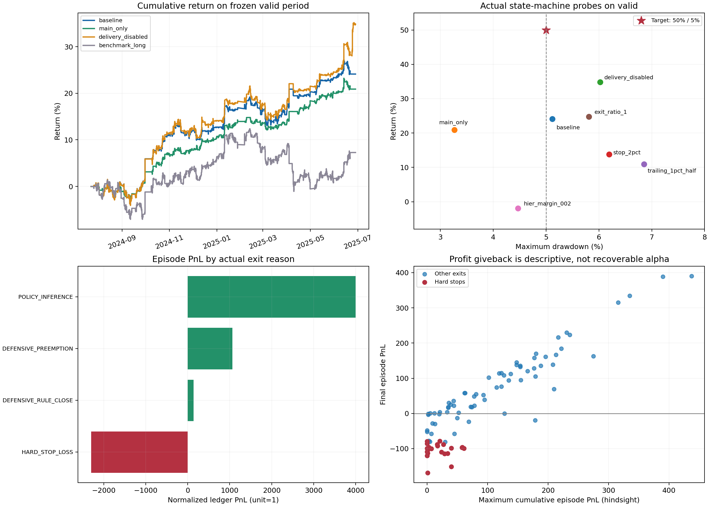

# fu 10min 双主力策略再诊断与收益回撤改进方案

分析日期：2026-10-21。基线：`1.txt` 调整 3 对应的 valid 产物，2024-07-23 至 2025-06-27。目标经确认是**同期间累计收益率至少 50%，最大回撤不超过 5%**。本文延续原报告的调查，保留旧报告作为历史记录。

**当前已形成有价值的交易能力，但还没有证明能在未见数据上实现 50% / 5%。** 最新基线为 24.1204% / 5.1169%，实际回放逐步复现。剩余问题主要是双合约同向风险、部分错误入场与持仓回吐、选择器评价路径与部署路径不一致，以及终局规则对评估切片边界的依赖。把止损收紧、直接删除负贡献 slot、提高门控阈值和加入简单移动止盈，在本次对照中都没有改善整体收益回撤关系。

本次完成 22 组真实 router 与环境回放，包括基线、消融、单项参数对照及简单策略基准。它们均使用当前 valid，属于研究实验，不能当作 22 组独立验证。未使用 test 收益进行选择，仅检查了 test 时间戳以核对数据分区。

金额均沿用当前 `contract_unit=1`、组合本金 12,000 的**归一化账本单位**，不直接等同于真实一手 fu 的人民币盈亏。上期所 fu 合约交易单位为 10 吨/手、报价为元/吨；真实资金、手数、保证金和盈亏须在同一乘数口径下核算，不能只把利润乘 10 来宣称收益提高。[上期所燃料油期货业务细则](https://www.shfe.cn/regulation/exchangerules/productrules/202512/t20251231_829966.html)



## 1 三轮调整的进步与当前缺口

| 状态 | 净利润 | 累计收益率 | 最大回撤 | 调仓次数 |
|---|---:|---:|---:|---:|
| 上一轮报告基线 | 451.13 | 3.7594% | 9.1013% | 284 |
| 1.txt 调整 1 | 1,298.23 | 10.8185% | 7.4946% | 286 |
| 1.txt 调整 2 | 1,491.36 | 12.4280% | 7.1094% | 300 |
| 1.txt 调整 3，当前可回放基线 | 2,894.45 | 24.1204% | 5.1169% | 180 |

前两轮新结果按用户记录引用；磁盘当前保留的是第三轮完整轨迹，因此不能用前三行的差额严密估计每一项代码改动的独立因果贡献。最新低层模型与高级门控参数的共同作用，须通过冻结其余因素的回放确认。

当前真实统计为 90 笔完整往返，53 胜、37 负，胜率 58.89%，profit factor 为 2.0066。180 次是开仓与平仓调仓次数。已盈利的活跃合约为 6/8；汇总中的 6/12 包含四支未交易合约，两者都不等于逐笔胜率。

50% 对应净利润 6,000，仍差 3,105.55；回撤超标 0.1169 个百分点。后者接近阈值，前者仍是实质差距。收益回撤比从当前约 4.71 提升至 10，需要提高交易质量与风险使用效率。

## 2 诊断回放与证据强度

快速检查复用生产 `calculate_metric`，重放保存的同步净值路径；完整检查调用生产 `vae_risk_aware_routing.run_single_valid_df` 与真实 `Base_Env`，没有替换交易执行模型。

```bash
source /home/lanceliang/miniconda3/etc/profile.d/conda.sh
conda activate finetf
python docs/research/fu_10min_replay_check.py --check-target
```

已运行输出：

```text
REPLAY PASS: net=2894.4499, TR=24.12041583%, MDD=5.11694885%, steps=8683
TARGET FAIL: TR>=50%, MDD<=5%
```

完整状态机基线耗时约 20.5 秒，12 支合约的每一步 reward 与原始文件通过 `assert_allclose`。逐笔拆分同时验证了：所有回合利润之和等于组合净利润；账户净值差等于逐步 PnL；单位仓位实际成交名义金额由手续费反推后，开平价差减费用等于回合利润。

研究性业绩目标不能像确定性软件缺陷一样承诺修复后必然变绿。本次交付诊断、复现工具和改进顺序，未改写生产策略或宣称已实现目标。下面的因果对照只支持“该项变更在当前冻结 valid 上造成什么影响”。

## 3 高级门控分数与收益不是同一个量

### 当前门控仍以分配模型为主

最新参数为：

| 参数 | 当前值 | 含义 |
|---|---:|---|
| slope window | 130 | 趋势轴截断窗口 |
| volatility window | 147 | 波动率轴截断窗口 |
| slope gamma | 0.925526 | 趋势轴衰减 |
| volatility gamma | 0.979882 | 波动率轴衰减 |
| slope 入场阈值 | 0.239118 | 绝对分位数门槛 |
| volatility 入场阈值 | 0.365379 | 绝对分位数门槛 |
| hysteresis exit ratio | 0.737524 | 持仓后下调拒识阈值 |
| action persistence | 6 | 约 60 分钟有效交易时间的动作持续 |

在角色允许、未处于当前终局防御且完成 147 步预热的 15,427 个时点中，有 14,991 个时点记录非防御路由，占 97.17%。其余时点还可能受止损或熔断影响，因此这不是单独 VAE 拒识率。即使如此，高层整体仍接近常开。

分数是 VAE 似然在各自训练分布中的分位数，经时间平滑得到，既不是上涨概率，也不是该 agent 盈利概率。不同模型各自计算的分位数，再除以分数总和，不能自动成为经过校准的后验概率。

真实推断时点的相对 margin 中位数为 slope 0.0338、volatility 0.0130，P90 为 0.0936、0.0359。原双层分级门控使用 0.12，明显高于当前大量分数的实际尺度：

| 门控对照 | 收益率 | MDD | 调仓 |
|---|---:|---:|---:|
| 当前绝对门控 | 24.12% | 5.12% | 180 |
| hierarchical，双轴 margin 0.12 | 0.00% | 0.00% | 0 |
| hierarchical，双轴 margin 0.02 | -1.95% | 4.47% | 292 |
| 仅 slope 阈值升至 0.55 | 10.08% | 6.79% | 242 |
| 仅 volatility 阈值升至 0.55 | 12.28% | 6.78% | 120 |
| 双轴均升至 0.55，组合对照 | 1.18% | 6.21% | 162 |
| 仅 volatility gamma 改为 0.925 | 8.59% | 6.38% | 206 |

双轴同时改阈值和 hierarchical 对照是明确标记的组合策略实验；单轴阈值实验用于区分各轴影响。它们不构成一次完整门控优化，也不能证明所有 hierarchical 参数都无效。

### 入场质量确有条件差异，但不能直接照表加门槛

90 笔入场按 volatility 最大权重分四组，组内净利润依次为 -437.72、906.95、895.21、1,530.00。最低组值得优先研究；然而将整条状态机阈值提高至 0.55，实际表现恶化。原因是新规则还改变持仓期间的退出、再入场和后续模型交接。

Q margin 同样不单调：四组回合净利润为 724.83、439.06、1,220.24、510.32。不能把 Q 差距或 VAE margin 当盈利概率，用一个全局阈值过滤所有 slot。

建议将高级门控拆成三个明确职责：

1. 极端状态拒识：经训练分布校准的 OOD 与数据质量底线。
2. 模型路由：在候选模型间选择，加入切换迟滞和持仓管理责任。
3. 交易准入：用过去可得的信息估计成本后收益、尾部损失和增量组合风险，允许主动选择 Flat。

第三项应以未来实际部署路径上的净效用为监督目标，并在内层时间验证中校准。先验证“分数能否把净收益排序”，再搜索阈值；单纯拉高生成模型分数阈值不是有效 alpha 过滤器。

## 4 门控优化目标仍有口径偏差

当前 Optuna 已启用 MDD 惩罚和最低调仓保护，这比旧版本进步明显，但仍有三个问题。

**收益分母与风险分母不同。** `vae_routing_util.py:2236` 附近按“发生交易的合约数 × 6,000”计算收益；随后同步组合 MDD 使用 12,000。当前 8 支活跃合约使搜索用收益率为 6.0301%，最终同步组合收益却为 24.1204%。若不同 trial 的活跃合约数量变化，排序还会受到不固定分母影响。即便数量不变，搜索输出也不能解释为最终组合收益率。

**WR 是盈利合约比例。** 当前为 6/12=0.5，包含未交易合约；它不是回合胜率。它与“组合达到 50% 收益、5% 回撤”的需求也不是同一目标。

**连续屏障不是硬约束。** MDD 超过 5% 后，当前因子为 `exp[-4 × (MDD−0.05)/0.05]`。在 5.1169% 时约为 0.911，因此稍高收益完全可以补偿超标风险。搜索选中不合规结果是该目标的正常行为。最低 60 次调仓也不能阻止依靠少量大额交易或低覆盖率达标。

建议统一使用同一共享本金的同步成本后收益。将 MDD≤5% 作为候选可行性条件，辅以最低有效交易覆盖率、最坏 fold 和尾部损失要求；可行集合内部再最大化未见时间 fold 的净收益。训练搜索阶段可以保留连续惩罚以提供梯度式排序，但最终候选不得仅凭加权总分越过风险硬门槛。

每个 trial 至少保存 TR、MDD、覆盖率、回合数、费用、最坏 fold、活跃合约数和配置哈希，形成收益回撤 Pareto 表。当前仅凭 `optuna_results.csv` 的 value 不能判断 400 个 trial 中有多少满足 5% 约束。

## 5 亏损来源与最大回撤

### 硬止损仍是主要亏损类别

| 退出方式 | 回合数 | 净利润 | 胜率 |
|---|---:|---:|---:|
| POLICY_INFERENCE | 58 | +3,996.22 | 75.86% |
| DEFENSIVE_PREEMPTION | 8 | +1,062.69 | 100.00% |
| DEFENSIVE_RULE_CLOSE | 2 | +136.11 | 50.00% |
| HARD_STOP_LOSS | 22 | -2,300.57 | 0.00% |

硬止损占全部亏损回合损失 2,875.43 的约 80%。这描述的是亏损最终如何结束，不能证明硬止损本身制造了全部损失。实际关闭止损后，收益降至 15.48%、回撤升至 10.35%，证明它当前有保护价值。

22 次止损中，18 次来自多头、14 次在次主力入场；这些是重叠分类。最差一笔是 fu2505 在 2025-04-08 22:20 入场做多，5 根 bar 后于 2025-04-09 09:00 退出，亏损 168.73。10min 决策和跨 session 跳空使 3% 止损只能在观察到行情后执行，不能视为价格损失绝不超过 3% 的保证。

| 风控对照 | 收益率 | MDD | 硬止损次数 |
|---|---:|---:|---:|
| 当前 3% | 24.12% | 5.12% | 22 |
| 收紧为 2% | 13.78% | 6.19% | 47 |
| 关闭硬止损 | 15.48% | 10.35% | 0 |

因此应保留确定性安全底线，优先减少进入错误方向的风险与重复入场。波动率调整的策略退出可以作为独立机制验证，但不得凭当前回测把安全底线当收益参数反复搜索。此顺序也符合 ADR-0047 对安全风控的定位。

### 最大回撤来自双合约同时做多

最大回撤从 2025-02-12 09:50 的权益 14,300.53，到 2025-03-05 22:30 的 13,568.78，净值减少 731.75。

| 同步回撤区间归因 | 净值变化 |
|---|---:|
| fu2505 多头步 | -375.96 |
| fu2507 多头步 | -333.89 |
| 两合约平仓步等费用 | -21.90 |

两支合约是同品种不同月份，不能视为两份独立风险。共同可用时点的主次合约单步价差变化相关性约 0.9266；同时持有两支合约的 5,864 个时点中，67.04% 为同方向持仓。

仅主力开仓的真实状态机对照为 **20.89% / 3.27%**，相对基线少赚 387.54，最大回撤下降约 36.1%。这说明次主力值得保留为条件性机会，但当前固定对称风险分配效率不足。其收益不能简单等同于“次主力入场回合利润”，因为移除次主力开仓会改变角色切换后的后续持仓路径。

下一步应构建按全局事件时间推进的组合风险控制器：限制主次合约同向净敞口、共享尾部损失预算，在主力机会相近时要求次主力提供额外净收益证据。组合 DD governor 应作为第二道保护，不能单靠触及 5% 后平仓来保证 5% 上限，跳空和成交限制仍会影响实现值。

当前按独立合约运行后再同步核算的结构，可以计算组合风险，却不能在执行时根据另一支合约仓位削减风险；需要调整回测编排后才能严密评估该控制器。实际整数手数限制下，也不能直接把“次主力 0.25 手”当作可执行方案。

## 6 应得盈利是否被错过

### 盈利回吐存在，峰值利润不是可获得利润

37 笔亏损中，31 笔曾有正的累计账本 PnL，16 笔曾达到至少 +20。90 笔交易各自历史最高累计 PnL 合计 8,353.21，最终保留 2,894.45，差额 5,458.76。

这个差额是事后路径诊断，不能称为待回收 alpha：不同峰值需要事先识别，提前退出还会改变再入场、费用和后续仓位。最明显的普通退出回吐是 fu2505，2025-01-23 15:00 入场，曾浮盈 178.97，最终亏损 19.05。另有 10 笔硬止损交易曾浮盈至少 20，值得研究可观察的退出退化信号。

真实退出对照已经否定了两个简单方案：

| 退出或持仓对照 | 收益率 | MDD | 调仓 |
|---|---:|---:|---:|
| 当前持仓持续 6 步 | 24.12% | 5.12% | 180 |
| 持仓持续 1 步 | 15.91% | 6.11% | 250 |
| 持仓持续 3 步 | 16.66% | 5.63% | 214 |
| 取消门控退出迟滞，ratio=1 | 24.78% | 5.81% | 180 |
| 浮盈约 1% 后回吐一半退出 | 10.92% | 6.86% | 330 |

最后一项是在当前 router 外增加基于已观察浮盈的诊断覆盖层，原持仓的 1% 近似阈值以当前名义金额计算；它允许退出后按原模型再入场，并未同时优化再入场规则。结果只否定这一具体覆盖层，不能否定所有追踪退出方法。

普通策略退出后，沿原方向再持有 6/12/24 根 bar 的事后毛价差合计为 -164/-423/-797。因此不存在“所有普通退出都太早”的证据。更合理的改进是识别特定状态下的长时间回吐与退出后反复追入，而非普遍延长持仓或普遍止盈。

### 终局边界规则确实影响大量机会

`vae_routing_util.py:1767` 使用 `timestamp.dt.date.unique()` 的最后 5 个日期作为终局防御。它同时存在两项语义限制：自然日期不等于 TradingDay；评估文件结束不等于合约到期。

fu2509、fu2510 在 valid 中都止于 2025-06-27，于是从 2025-06-23 09:00 起各有 195 行被判为终局。它们当时分别仍是主力与次主力。关闭该规则的**诊断对照**将收益提高至 34.84%，MDD 为 6.03%，净利润增加 1,286.40。其中 fu2509 增加 400.22、fu2510 增加 396.22。

这一总增量还包括其他合约的终局变化，不能全部归因于 valid 截断，更不能把“永久关闭交割防御”作为解决方案。

最小实际代码路径检查只执行至环境构造前的终局 mask 生成：

```bash
conda activate finetf
python docs/research/fu_10min_terminal_boundary_check.py
```

```text
TERMINAL PREFIX FAIL: 78 historical masks change when two future dates are appended
First changed decision: 2025-06-19 09:00:00; prefix=True, extended=False
```

**这符合 ADR-0058 的既定切片尾部锚定设计，属于应重开设计决定的问题。** 建议区分真实合约停止交易、数据预处理停止准入、评估窗口结束三个事件。真实交割防御应绑定决策时已知的合约生命周期与 TradingDay；评估结束处的账面收尾单列，不应提前数日屏蔽交易。修复后要求增加未来数据不改变历史准入，夜盘归属也须正确。

## 7 子模型选择仍缺少部署路径验证

### 新 slot 6 已经不能按旧结论处理

| 入场 slot | 回合数 | 回合净利润 | 硬止损数 | 当前 slot 各步净利润 |
|---:|---:|---:|---:|---:|
| 0 | 3 | +528.47 | 0 | -128.72 |
| 1 | 0 | 0.00 | 0 | -84.00 |
| 2 | 4 | +276.41 | 0 | +262.39 |
| 3 | 12 | +390.96 | 2 | -245.96 |
| 4 | 11 | -153.44 | 4 | +100.13 |
| 5 | 2 | +122.45 | 0 | -71.57 |
| 6 | 27 | +527.04 | 9 | +1,240.24 |
| 7 | 15 | +288.01 | 4 | +319.10 |
| 8 | 16 | +914.54 | 3 | +1,597.13 |

防御 slot 9 各步净利润为 -94.30，主要包括平仓摩擦。两种归因不同：入场 slot 承担整笔交易，当前 slot 仅承担当步账本增量。它们都不能直接解释为单个网络的独立贡献。

90 笔交易中，88 笔经过多个非防御 slot，平均经历 4.64 个 slot；81 笔入场与退出 slot 不同。一笔交易可以由某模型建立，再交给另一个模型持有，最后由第三个模型或硬规则退出。当前用分段独立回测选择模型，不能充分评价这种组合行为。

| 子模型对照 | 收益率 | MDD | 调仓 |
|---|---:|---:|---:|
| 当前模型组合 | 24.12% | 5.12% | 180 |
| slot 6 设为空仓 | 3.19% | 5.48% | 474 |
| slot 8 设为空仓 | -5.29% | 10.44% | 430 |
| slot 4 设为空仓 | 19.02% | 5.40% | 306 |
| 仅 slot 4 换为排名第二候选 | 21.87% | 5.38% | 176 |

关闭 slot 的对照测量的是整个路由切片触发强平的效果，不能当作纯粹剥离某模型所有历史交易。slot 4 入场回合虽然为负，直接删除仍损害全路径结果。第二候选 `epoch_50:bin_4` 替换原 `epoch_49:bin_7` 也没有改善；两者原始 PairScore 分别为 0.304041 与 0.306120，差距仅约 0.68%，排序证据并不充分。

### 门禁实际强度与文档初衷仍有差距

当前 Selection Manifest 中：LCB z=0.2；核心与长尾最少 joint 合约数均为 3；盈利合约比例均为 60%；离线硬止损门禁关闭；采用 contract-equal 与 reward 口径；边际均值强制为正，但 `min_lcb=0` 时边际 LCB 检查被旁路。

这与 ADR-0059 初始方案和 CONTEXT 中更严格的定义存在差别，ADR-0059 后段已经解释了部分生产校准。不能把初始的 6/4 合约门槛、z=1.0以上、全部 LCB 为正，当作当前已经执行的事实。

用已保存的均值与标准误重算更强联合、边际 LCB，发现 z=1.0 时 slot 6 没有合格模型；z=1.28 时 slot 0/5/6 均为空。这是离线证据敏感性，不是重选后的收益回测。结合关闭 slot 6 的真实结果，说明“一次性把所有 LCB 门禁拉高”也会切掉当前重要机会。

标准误把不同月份合约当成独立证据，但主次合约共享很多市场冲击。增加合约数不等于获得同等数量独立样本。另一方面，要求专业模型在所有边际状态都显著为正，又可能误杀联合工况中的有效模型。

建议把 Stage II 改为部署条件下的两阶段选拔：

1. 用统一角色、资金、费用和实际风险规则，快速筛出每个 slot 的少量候选；保留当前均值门禁作为基础检查。
2. 对候选执行连续时间、多合约同步的真实路由回放；加入冷启动、从其他 agent 接手已有持仓、止损后重入、跨角色持有等初始条件。
3. 以时间块与持仓回合为证据单位，保存最差 fold、成本后净收益、尾部风险、主次角色增量和实际流量；对候选分数差做区块 bootstrap 与排序稳定性分析。
4. 只有候选在未用于排序的时间块改善全组合结果才替换。空槽策略区分“禁止新增风险”与“强制平掉已建仓位”，硬安全防御仍优先；后者会改变 ADR-0059 的现有空仓降级语义，应单独评审。

9 个逻辑 slot 实际只有 8 个不同 checkpoint/bin 组合，slot 1 与 slot 6 使用同一个 `epoch_35:bin_2`；另外多个 slot 使用同一 bin 的不同 epoch。它们可以在不同状态有效，但不能据此宣称已经得到 9 个独立、互补的 alpha。

## 8 Agent 风格与训练激励

按 ADR-0007，以入场前五个 mark price 的先行动量分类，使用当前真实持仓回合：

| 入场行为风格 | 回合数 | 净利润 | 胜率 | 单回合均值 |
|---|---:|---:|---:|---:|
| 趋势追随 | 38 | +1,788.79 | 65.79% | +47.07 |
| 均值回归 | 49 | +875.91 | 51.02% | +17.88 |
| 未分类 | 3 | +229.75 | 100.00% | +76.58 |

这里描述的是入场行为，不能倒推每个网络的固定风格，尤其多数交易会跨模型管理。均值回归也并非全部无效：slot 6 的均值回归入场为正；slot 7 的均值回归入场 10 笔合计 -173.75，趋势入场 5 笔为 +461.76。样本仍少，适合作为下一轮条件假设，尚不适合直接硬编码禁止某类交易。

当前有 61 笔多头、29 笔空头，分别贡献 2,132.72 与 761.73；两侧都盈利。符合准入的时点中，约 66.1% 做多、23.5% 做空、10.4% 空仓。它表现为偏多、较长时间持仓、兼有逆短动量入场的波段策略。

持仓中位数 112 根、均值 154.43 根 10min bar，约为 18.7 和 25.7 个有效交易小时，跨休市时自然时间更长。26 笔持仓达到至少 180 根 bar；环境把持仓时长输入在 180 步封顶，使更长时间持仓不再通过该维度区分。

训练脚本使用 0.002 交易成本，另外设置 `turnover_base_rate=0.002`、`turnover_adverse_ratio=5`；最终执行费率为 0.0003。以价格 3,000、单位仓位说明量级：训练单边费用约 6，基础 shaping 约 6，逆势或被判为趋势早退时 shaping 可达约 30，而最终单边手续费约 0.9。它们共同鼓励持仓惯性，也可能让某些退出过于迟钝。

这是有代码依据的激励差异，尚未通过重训证实为损失根因。建议重训时分别对照成本压力、基础换手惩罚、方向性退出惩罚；每轮只改一项，DP 专家与 RL 奖励保持一致。不能为了减少回吐直接取消全部持仓惯性，本次 persistence 1/3 和移动止盈都已显示副作用。

此外，已有 `trading_info` 包含持仓方向、当前持仓收益、最大回撤和持仓时长；不能再把“模型完全看不到自身持仓风险”列为根因。应先校验这些输入的训练部署分布、缩放和时长饱和，再决定是否增加峰值浮盈、距峰值时间、已承担风险和组合暴露等状态。

## 9 Alpha 与 beta 的当前证据

Beta 是对系统性收益来源的暴露，不以数量越多越好为目标。当前尤其需要减少两支合约同向的重复暴露；alpha 则须在合理基准和未用于选择的数据上验证。

三个基准都调用同一执行环境与风险状态机，保持角色准入、预热、交割终局、持仓持续、费用与硬止损，关闭 VAE 阈值；持续做多或以过去 48/12 根 bar 价格变化方向生成动作。它们是可复跑的简单策略对照，不是最佳市场因子或优化过的趋势策略。

| 策略 | 收益率 | MDD | 调仓 |
|---|---:|---:|---:|
| 当前 DiHFT | 24.12% | 5.12% | 180 |
| 持续做多，含当前风险规则 | 7.28% | 11.94% | 54 |
| 48 bar 动量 | -1.16% | 18.28% | 818 |
| 12 bar 动量 | -34.27% | 35.71% | 1,806 |

当前收益不容易由这个简单持续多头对照解释；短动量策略高换手失效，也说明微观方向预测必须跨过成本门槛。它们没有穷尽其他趋势、carry、期限结构或风险溢价基准，因此超越这些弱基准仍不能直接等同于稳定 alpha。

对 225 个有数据的自然日期，将各策略 PnL 除以固定 12,000，做描述性回归：当前策略增量 = 截距 + β₁×持续多头增量 + β₂×48bar 动量增量。得到 β₁≈0.461、β₂≈0.240、R²≈0.415，截距对应全期间约 +2,524.93。HAC 5 阶截距 t≈2.16。

**该回归为同一已反复筛选 valid 的事后风格解释，因子也是带风险规则的策略，截距不能认定为可复制 alpha；t 值没有校正模型与参数选择。** 它提示现有收益中可能存在超越简单暴露的择时/执行能力，下一步应把这种残差放到全新时间块上验证。多次回测筛选会放大虚假发现风险，不能把单次显著性当作选模后的有效性证明。[Bailey 等人的原始研究](https://www.davidhbailey.com/dhbpapers/backtest-prob.pdf)

新增信号的优先候选应围绕已经观察到的不足：慢趋势变化与回调恢复、主次合约相对强弱/价差变化、逆势入场后的继续恶化、跨 session 跳空风险。每项都需证明在现有策略之外提供成本后增量，并在相同净敞口或风险预算下比较；不要直接增加几十个相似技术指标。

## 10 泛化能力尚未通过的环节

训练时间边界到 2024-07-22，valid 从 2024-07-23 开始；test 时间戳从 2025-06-30 开始。时间分区存在，但 low-level 418 个候选的筛选、高层 400 trial、1.txt 的三轮反馈及本次 22 组诊断都使用 valid。后半段 valid 即便在统计表中单独盈利，也不能重新称为未见样本。

当前有 10/12 个自然月份盈利，仅 2024-08 与 2025-02 为负，这是稳定性线索，不是独立泛化认证。不同月份合约也高度同步，不能通过单纯留一合约验证解决时间信息复用。

建议采用按全市场时间切块的嵌套 walk-forward：外层一整段时间同时留出所有合约；内层仅用更早时段选择特征、子模型和门控参数；每层依据持仓、标签及预测期限做 purge/embargo。已有 valid 已用于设计，不可通过重新命名分块“恢复干净”；最终需要尚未用于任何选择的 test 或以后新增数据，且先冻结整个方案。

同一真实合约跨 train/valid 或 valid/test 并不自动构成泄漏，关键是时间边界、特征拟合窗口、标签跨界和账户/预热状态的处理。需要检查跨边界是否因重复预热丢失一段交易、是否把切片结束当到期。高层 VAE OOD 也不能替代低层 policy OOD；按 ADR-0034 在真实持仓上下文下校准动作分歧、Q 值漂移和隐空间距离，不能直接比较不同 epoch 的 Q 绝对尺度。

本次复核当前实际特征数组和已保存训练审计，仍为 RL 153 维、slope 16 维、volatility 12 维。具有 forward PSI 记录的特征分别是 136/153、15/16、11/12；这些已记录特征的 P90 / 最大 PSI 分别为 0.294 / 0.685、0.098 / 0.128、0.061 / 0.064。未记录项不能视作已通过漂移检验。这里是旧审计产物的重新核对，未重新计算完整原始行情 OOD，也不能证明漂移造成了本次亏损。

稳定 RL 特征子集重训仍值得做，但应冻结具体 manifest，与完整特征版本对照；不在推理时删掉既有模型输入列。先用新的未见时间块确认漂移与亏损是否相关，再决定删改哪些特征。

## 11 计量与审计问题需要先修

以下问题不等同于 alpha 不足，却会使后续诊断、排序和发布判断失真。

1. **审计成交价错位。** `_record_trade_audit` 在 `env.step` 后使用已经推进的 `current_markprice`，再叠加执行滑点构造 fill，未直接读取本次实际成交价格。检查 180 个单位成交，有 133 个不满足 `commission = |fill × quantity| × 0.0003`。账户净值本身可对账；审计 fill 字段不能直接拿来分析漏赚或执行质量。
2. **单合约 return_rate 分母仍可能为零。** 当前 `contract_results.csv` 的 `require_money=0` 产生 10¹³～10¹⁵ 量级收益率；聚合 `equal_weighted_mean_return` 同样失真。同步组合 TR 和 MDD 不依赖这个异常比值，本次统一用净值与固定本金。
3. **诊断金额与资金展示仍有乘数混用。** 普通 diagnostics 汇总显示 720,000 初始总本金和 28,944.50 净利润，同步组合则为 12,000 和 2,894.45；不可把两张表金额或收益率直接比较。
4. **Sharpe 不是按真实交易日计算。** 最终同步报告传入 `freq=12`，`calculate_metric` 每 12 根 bar 当一“日”并乘 √365。10min 数据的 12 根 bar 只是约两小时有效交易时间。因此 1.5863 只能视为旧实现指标，须按 TradingDay 聚合净值后重新年化。这个问题不改变当前 TR 与逐步 MDD。
5. **报告仍写 30min。** 8,683 根的时间线是本次 10min 数据，不能根据文案推算持仓时长。

审计最小回放：

```bash
conda activate finetf
python docs/research/fu_10min_replay_check.py --check-audit
```

```text
REPLAY PASS: net=2894.4499, TR=24.12041583%, MDD=5.11694885%, steps=8683
AUDIT FAIL: fee/fill mismatch 133/180 unit-size fills
```

修复时应从环境交易结果返回真实 reference/fill/quantity/fee，保证订单、账户与 PnL 守恒；单独测试开、平、反手、部分成交及零费率。真实 TradingDay 映射应覆盖夜盘，不能将本次回归用的自然日分组直接升级为正式日度业绩。

## 12 朝 50% 收益与 5% 回撤推进的顺序

### 第一步 修复计量与终局语义

统一共享资金分母、真实成交审计、合约交易单位、TradingDay 日度业绩；重开 ADR-0058，拆分真实生命周期与数据边界。验收是净值守恒、追加未来数据不改变历史决策、搜索回放与最终回放一致。这一步不能预先承诺获得关闭全部终局防御对照中的 1,286.40 增益。

### 第二步 先以主力为风险基准构建同步组合控制

用 20.89% / 3.27% 的主力开仓版本作为验证期风险参照；保留当前 24.12% / 5.12% 为机会参照。在全局时间步上加入同向净敞口预算和次主力增量准入；比较相同资金、相同成交规则、相近覆盖率下的收益与风险。主次相关性控制是当前最有直接证据的风险改进方向。

### 第三步 重做子模型与交接评价

对高流量 slot 6/8 和有回吐线索的 slot 4/7，保留多候选，按完整连续路径评价模型进入、接手与退出的共同作用。优先构建可校准的交易效用门控，再尝试迟滞、路由切换和退化风格识别。固定硬风控底线，避免为了填满 9 个槽位不断放宽证据标准。

### 第四步 增加可验证的净收益来源

拆开趋势追随与均值回归的训练/评估目标，研究较慢且换手成本可承受的信号；用真实弱势恢复信号约束逆势入场，而不是把所有逆势交易禁止。对退出奖励做单变量重训消融，保持 DP 与 RL 契约一致。新增收益必须通过外层时间验证，同时报告对原策略的净增量、同向暴露和尾部损失。

### 第五步 一次性冻结验收

先冻结模型、门控、角色、终局、执行、资金与风险规则，再在未参与选择的数据上验收：同期间口径 TR≥50%、同步 MDD≤5%；同时报告最坏时间块、成本压力、实际回合数、交易覆盖率、真实日度风险和相对基准残差。风险边界需要留出滑点与跳空缓冲；具体预算由未见数据的压力结果确定，不把恰好 4.99% 当作可靠余量。

### 当前结果不能靠资金缩放直接达到目标

固定当前 PnL 路径把仓位线性放大 2.0729 倍，收益可以算到 50%，但按净值重新计算 MDD 为 10.17%；主力版本放大到 50%，MDD 仍约 7.77%。这些只是固定路径敏感性，实际加仓还会改变成交、保证金和风险状态。

即使假设全部执行摩擦都消失，当前参考价毛利润 3,275 也只有 27.29%。若事后删除所有硬止损交易而不改变其他路径，只能算到 43.29%；连全部亏损回合都事后抹去，也只有 48.08%。这些都不是可执行策略，却清楚说明：**仅压费用、删亏损或放大仓位，不能证明 50% / 5% 可达。需要新的净收益、已有盈利的可实现保留，以及组合风险改善同时发生。**

## 13 复跑与证据索引

完整表格见 `fu_10min_followup_evidence/all_probes.csv`，包括全部 22 组结果。`episodes.csv` 为 90 笔往返；`steps.csv` 为逐合约逐步归因；`episode_handoffs.csv` 记录跨 slot 管理；`drawdown_attribution.csv`、`entry_quality_*.csv`、`selector_lcb_sensitivity.csv` 分别支持回撤、条件质量与选择证据分析。`input_fingerprints.json` 固定代码提交、输入文件和模型 SHA256。

```bash
source /home/lanceliang/miniconda3/etc/profile.d/conda.sh
conda activate finetf
# 快速净值一致性检查，预期通过
python docs/research/fu_10min_replay_check.py
# 目标检查、审计检查和终局因果检查在当前代码下预期失败
python docs/research/fu_10min_replay_check.py --check-target
python docs/research/fu_10min_replay_check.py --check-audit
python docs/research/fu_10min_terminal_boundary_check.py
# 逐笔归因与真实状态机实验，均不覆盖原生产结果
python docs/research/fu_10min_followup_analysis.py
python docs/research/fu_10min_state_machine_probe.py
python docs/research/fu_10min_state_machine_probe.py slot4_flat delivery_disabled slope_threshold_055 vol_threshold_055 vol_gamma_0925 trailing_1pct_half benchmark_long benchmark_mom48 benchmark_mom12 slot4_second_candidate
python docs/research/fu_10min_followup_summary.py
```

状态机默认执行前 12 个基线与消融案例；显式列出案例的调用写入独立 extra 汇总。脚本只写研究目录、不改变生产模型。selector LCB 敏感性表为已保存统计量重算，不能替代重新路由后的业绩。

诊断结论是：当前优势值得保留，slot 6/8 与持仓惯性有明确作用；剩余改进首先应落在边界语义、同向组合风险和部署路径选模。50% / 5% 仍是待验证目标，本次没有将任何样本内变体批准为最终方案。
